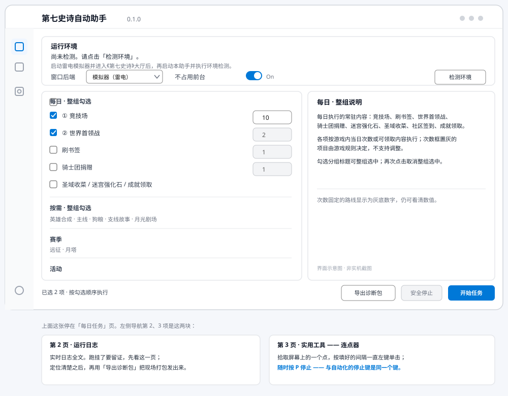

<div align="center">

# 第七史诗自动助手

**基于窗口截图 + OpenCV 模板匹配的《第七史诗》PVE 自动化**

<sub>免费 · 开源 · 不读内存 · 不注入 · 不改游戏文件</sub>

<div>
  
  
  
</div>
<div>
  
  
</div>

学习实践 __视觉判据 & 失败关闭__ 的一次工程尝试

✨ 如果觉得有用，欢迎右上角点亮 `Star` 支持 ✨

</div>

---

## 🚀 功能介绍

<div align="left">

🧹 __日常清理__：每天一次的对战、收菜、捐赠、签到与领取类路线

📖 __剧情与养成__：主线推进与补星、支线与活动剧情、养成材料与合成

🛒 __资源与商店__：秘密商店刷书签（只买誓约 / 神秘书签）与其它消耗类路线

🖥️ __双后端__：雷电模拟器与《第七史诗》PC 客户端都能跑；界面只放行已通过验收的组合，实际验到哪一步见[证据矩阵](docs/SAFETY_MATRIX.md)

🛡️ __失败关闭__：只在认出预期页面时点击；陌生页面、黑屏、遮挡、转场超时一律留证停止

📋 __证据优先__：每次点击前后都要有可证伪的画面判据，点击不等于成功

🖱️ __后台输入__：PC 端默认走后台点击通道，运行时不必让出前台；键盘与滑动仍走前台，且后台点击会移动真实鼠标

</div>

> 路线清单与逐条说明见 [现状速查](docs/STATUS.md)；怎么勾选、怎么跑见 [使用手册](docs/USER_GUIDE.md)。

## 📸 界面一览

<div align="center">



*✨ 勾选顺序即执行顺序 · 开始前自动复检 · 实时日志 · 一键导出诊断包 ✨*

</div>

## ⚡ 快速开始

环境：Windows · Python 3.13（本项目验证过的版本）· 游戏语言**简体中文** · 雷电模拟器或 PC 客户端 · 基准画布 `1982 × 1132`。

**1. 安装**（仓库需克隆为 `auto_game_unified`，命令从它的**父目录**执行）

```powershell
git clone https://github.com/Kangkangnice/epic7-automation.git auto_game_unified
python -m pip install -r auto_game_unified\requirements.txt
```

**2. 启动桌面界面**

```powershell
python -u -m auto_game_unified.desktop
```

**3. 使用**：先启动模拟器 / PC 客户端并进入游戏 → 点「检测环境」→ 勾选路线（可填次数）→ 点「开始任务」。日常使用建议用[无窗口入口](docs/USER_GUIDE.md)，双击桌面图标即可。

> 命令行入口 `python -m auto_game_unified.main` 保留给开发调试；**默认是干跑**。实跑需要 `--live --confirm RUN`，次数按路线而定：可调次数的路线必填正整数 `--max-cycles`，固定次数路线自动取默认值（如世界首领战 2 次、英雄合成 1 次），刷书签可为 `0`（只扫不刷新），每日编排的次数写在 `--daily-tasks` 里。示例与例外见[使用手册](docs/USER_GUIDE.md#6-模拟器前台实跑)。
>
> 自己构建免安装版、校验第三方输入与自检报告，见 [贡献指南](CONTRIBUTING.md) 的「打包」一节。

> 🧰 界面左侧有四个入口：**每日任务** / **运行日志** / **实用工具**（目前是固定点连点器）/ **次元探查**（可选的第三方内置流程，与每日任务、连点器互斥），底部是「关于」。2026-11-09 起只有这一套界面了（原来的 Tk 版已删除），依赖也合并进了 `requirements.txt`。

## 🗂️ 路线与后端

**能否启动**只看[现状速查](docs/STATUS.md)：路线名单、默认次数、模拟器 / PC 放行状态由代码生成。
**实际验到哪一步**看[安全与证据矩阵](docs/SAFETY_MATRIX.md)与各路线手册，两者不是一回事：

- 主线补星（`story_star`）已在 PC 界面放行，但六章扫完收工尚未跑到，目前只验到连续四关的段落衔接。
- 活动小游戏（`survivor`）需要人工停在「选第一张卡」页，起点与终点都在该页，不参与回大厅衔接。

活动路线与其它路线互斥，且需要人工停在指定页面；逐条边界见
[使用手册](docs/USER_GUIDE.md) 与 [文档索引](docs/README.md)。

## 📚 文档

| | |
| --- | --- |
| 📊 [现状速查](docs/STATUS.md) | 路线名单、PC 放行情况、每日任务顺序（自动生成） |
| 🗂️ [文档索引](docs/README.md) | 我要做 X 该看哪份；文档怎么组织、怎么写 |
| 📖 [使用手册](docs/USER_GUIDE.md) | 安装、界面、干跑 / 实跑、日志、停止与退出码 |
| 🛡️ [安全矩阵](docs/SAFETY_MATRIX.md) | 哪些动作花资源、靠什么拦住误点；每条路线的实机证据表 |
| 🏗️ [架构说明](docs/ARCHITECTURE.md) | 分层、运行时、证据模型与 Runner 主循环 |
| 🔗 [页面转场契约](docs/TRANSITION_CONTRACTS.md) | 五段式证据、fail-closed 与接力规则 |
| 🖥️ [PC 客户端接入指南](docs/PC_TEMPLATE_MIGRATION.md) | PC 抓帧、模板差异与逐路线验收状态 |
| 🩺 [故障排查](docs/TROUBLESHOOTING.md) | 认不出、点不动、黑屏时先看这里 |
| 🧩 [新增自动化路线](docs/EXTENDING.md) | 复用优先的证据先于代码流程 |
| 🤝 [贡献指南](CONTRIBUTING.md) | 开发环境、测试范围、提交门禁与协作约定 |
| 📦 [发布手册](docs/howto/release.md) | 发版检查、离线回归与回退条件 |
| 🧭 [项目治理](GOVERNANCE.md) | 评审职责、放行与维护者分工 |
| 🔒 [安全政策](SECURITY.md) | 漏洞反馈与数据处理说明 |

## 🛡️ 资源消耗与安全边界

助手**不是零消耗**：多条路线会按设置花费游戏内资源。默认值以[使用手册 §3.1 路线可选项](docs/USER_GUIDE.md#31-路线可选项)为准。

**默认就会花（不需要额外开关）**

| 资源 | 触发条件 |
|---|---|
| 生命之叶 | 主线、主线补星、狗粮、世界首领战、支线故事、月塔体力不足时自动补充，默认不设上限 |
| 友情点 | 竞技场旗帜不足时按 `100 友情点 → 5 旗帜` 购买；刷书签与迷宫强化石会购买友情点（刷书签上限 10 个） |
| 社区积分 | 社区签到兑换行动力与强化石 |
| 红叶 / 金币 / 讨伐材料 | 企鹅批量购买、装备制作本身消耗 |

**必须主动开启才会花**

| 资源 | 选项 | 默认 |
|---|---|---|
| 天空石 | 竞技场天空石购旗（含次数上限） | 关闭，上限 0 |
| 金币 | 竞技场金币刷新对手（含次数上限） | 关闭，上限 0 |
| 红叶 / 天空石 | 宠物商店用品购入 | 关闭 |

其余底线：干跑是默认，不加 `--live --confirm RUN` 不会发出点击；认不出页面、证据冲突或回执不明确时停止并留证；已确认的不可逆动作不重复点击；月光剧场的 500,000 金币购票确认只点「取消」；随时可用 `P` 键、界面停止按钮或停止信号文件停止。

完整清单见 [安全矩阵](docs/SAFETY_MATRIX.md) 与 [使用手册](docs/USER_GUIDE.md) 第 12 节。

## ⚠️ 免责声明

📌 本项目仅供技术学习与交流，免费开源，作者保留最终解释权

🎨 《第七史诗》相关素材与商标版权归原权利方所有

⚖️ 使用任何第三方辅助工具均可能违反游戏用户协议，账号风险与后果由使用者自行承担

🚫 本项目未授权任何个人、商家或自媒体进行售卖；若遇到商家用它代练收费，相关后果与本项目无关

🚫 作者不提供任何「售后」或代练服务

🔒 所有日志、截图与诊断文件默认只留在本机；QQ 机器人通知为可选功能，不配置就不联网

## 🌟 参与贡献

判据和模板仍有未覆盖的页面。欢迎提 [Issue](https://github.com/Kangkangnice/epic7-automation/issues) 或 PR —— 尤其是**带当帧截图和真实分数**的失败现场，那是最有价值的贡献。

动手前请先读 [贡献指南](CONTRIBUTING.md)（含「人和 AI 怎么配合做新路线」）：改视觉判据、点击、导航或路线前，必须先补证据、补反例、补测试。

## ☕ 支持一下

<div align="center">

个人项目，没有赞助码，也没有服务器要养。

⭐ **点个 Star 就是最好的支持** ⭐

版本变化见 [CHANGELOG.md](CHANGELOG.md) · 许可：[MIT](LICENSE)

游戏素材与第三方组件的权利范围见 [素材声明](NOTICE.md)。本项目与游戏运营方无关联，使用前请核对适用的游戏规则。

</div>
