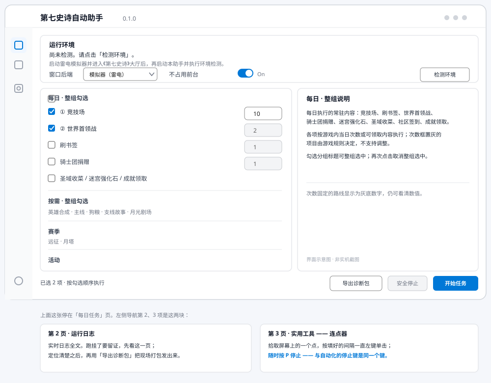

<div align="center">

# 第七史诗自动助手

**基于窗口截图 + OpenCV 模板匹配的《第七史诗》PVE 自动化**

<sub>免费 · 开源 · 不读内存 · 不注入 · 不改游戏文件</sub>

<div>
  
  
  
  
</div>
<div>
  
  
</div>

学习实践 __视觉判据 & 失败关闭__ 的一次工程尝试

✨ 如果觉得有用，欢迎右上角点亮 `Star` 支持 ✨

</div>

---

## 🚀 功能介绍

<div align="left">

🧹 __日常清理__：竞技场、世界首领战、骑士团捐赠、迷宫强化石、圣域收菜、社区签到、成就领取

📖 __剧情与养成__：主线、支线故事、月塔、远征、狗粮、英雄合成、月光剧场

🛒 __资源与商店__：秘密商店刷书签（只买誓约 / 神秘书签）、活动剧情、限时活动

🖥️ __双后端__：雷电模拟器与《第七史诗》PC 客户端都能跑，界面只放行已实跑验收的路线

🛡️ __失败关闭__：只在认出预期页面时点击；陌生页面、黑屏、遮挡、转场超时一律留证停止

📋 __证据优先__：每次点击前后都要有可证伪的画面判据，「点了」永远不等于「成了」

🧪 __后台点击（实验）__：PC 端可选后台点击通道，默认仍抢前台；滑动没有后台方案，且后台点击会移动真实鼠标（**真机尚未验通**）

</div>

> 路线清单与逐条说明见 [现状速查](docs/STATUS.md) 与 [完整参考](docs/REFERENCE.md)；怎么勾选、怎么跑见 [使用手册](docs/USER_GUIDE.md)。

## 📸 界面一览

<div align="center">



*✨ 勾选顺序即执行顺序 · 开始前自动复检 · 实时日志 · 一键导出诊断包 ✨*

</div>

## ⚡ 快速开始

环境：Windows · Python 3.10+ · 游戏语言**简体中文** · 雷电模拟器或 PC 客户端 · 基准画布 `1982 × 1132`。

**1. 安装**（仓库需克隆为 `auto_game_unified`，命令从它的**父目录**执行）

```powershell
git clone https://github.com/Kangkangnice/epic7-automation.git auto_game_unified
python -m pip install -r auto_game_unified\requirements.txt
```

**2. 启动桌面界面**

```powershell
python -u -m auto_game_unified.desktop
```

**3. 使用**：先启动模拟器 / PC 客户端并进入游戏 → 点「检测环境」→ 勾选路线（可填次数）→ 点「开始任务」。日常使用建议用[无窗口入口](docs/USER_GUIDE.md)，双击桌面图标即可。

> 命令行入口 `python -m auto_game_unified.main` 保留给开发调试；**默认是干跑**，实跑必须显式加 `--live --confirm RUN`。

> 🎨 **Qt / Fluent 预览界面**（可选）：`python -m pip install -r requirements-qt.txt` 后执行 `python -m auto_game_unified.desktop_qt`。它和原界面共用同一份业务控制器，默认入口仍是上面的 Tk 版。

## 🗂️ 路线一览

| 分组 | 路线 |
| --- | --- |
| 每日 | 竞技场 · 刷书签 · 世界首领战 · 骑士团捐赠 · 迷宫强化石 · 圣域收菜 · 社区签到 · 成就领取 |
| 按需 | 英雄合成 · 主线 · 狗粮 · 支线故事 · 月光剧场 |
| 赛季 | 远征 · 月塔 |
| 活动 | 限时活动 · 活动剧情 |

具体条数与 PC 放行名单见 [现状速查](docs/STATUS.md) —— 那一页由代码生成，不会过期。活动路线与其它路线互斥，且需要人工停在指定页面。逐条边界与限制见 [完整参考](docs/REFERENCE.md)。

## 📚 文档

| | |
| --- | --- |
| 📊 [现状速查](docs/STATUS.md) | 路线名单、PC 放行情况、每日任务顺序（自动生成） |
| 🗂️ [文档索引](docs/README.md) | 我要做 X 该看哪份；文档怎么组织、怎么写 |
| 📖 [使用手册](docs/USER_GUIDE.md) | 安装、界面、干跑 / 实跑、日志、停止与退出码 |
| 📦 [完整参考](docs/REFERENCE.md) | 逐条路线说明、命令行全参数、通知与测试 |
| 🏗️ [架构说明](docs/ARCHITECTURE.md) | 分层、运行时、证据模型与 Runner 主循环 |
| 🔗 [页面转场契约](docs/TRANSITION_CONTRACTS.md) | 五段式证据、fail-closed 与接力规则 |
| 🖥️ [PC 客户端接入指南](docs/PC_TEMPLATE_MIGRATION.md) | PC 抓帧、模板差异与逐路线验收状态 |
| 🩺 [故障排查](docs/TROUBLESHOOTING.md) | 认不出、点不动、黑屏时先看这里 |
| 🧩 [新增自动化路线](docs/EXTENDING.md) | 复用优先的证据先于代码流程 |
| 🤝 [贡献指南](CONTRIBUTING.md) | 提交门禁、测试与协作约定 |
| 🔒 [安全政策](SECURITY.md) | 漏洞反馈与数据处理说明 |

## 🛡️ 安全边界

- **干跑是默认**：不显式加 `--live --confirm RUN`，一个点击都不会发出去。
- **绝不点危险按钮**：钻石购买、付费确认、买票、重新抽取等路径在代码里被显式禁止。
- **资源只认不买**：体力 / 旗帜 / 门票不足时停止并留证，不自动补充付费资源。
- **每条路线收尾回大厅**：完成判定靠「重新认出稳定入口」，不靠「点过确认按钮」。
- **可随时安全停止**：`P` 全局热键、界面停止按钮、停止信号文件三条通道。

完整的安全原则见 [完整参考](docs/REFERENCE.md#安全原则) 与 [使用手册](docs/USER_GUIDE.md) 第 12 节。

## ⚠️ 免责声明

📌 本项目仅供技术学习与交流，免费开源，作者保留最终解释权

🎨 《第七史诗》相关素材与商标版权归原权利方所有

⚖️ 使用任何第三方辅助工具均可能违反游戏用户协议，账号风险与后果由使用者自行承担

🚫 本项目未授权任何个人、商家或自媒体进行售卖；若遇到商家用它代练收费，相关后果与本项目无关

🚫 作者不提供任何「售后」或代练服务

🔒 所有日志、截图与诊断文件默认只留在本机；QQ 机器人通知为可选功能，不配置就不联网

## 🌟 参与贡献

一个人也能把日常跑干净，但判据和模板永远有没覆盖到的页面。欢迎提 [Issue](https://github.com/Kangkangnice/epic7-automation/issues) 或 PR —— 尤其是**带当帧截图和真实分数**的失败现场，那是最有价值的贡献。

动手前请先读 [贡献指南](CONTRIBUTING.md) 与 [协作流程](docs/HUMAN_AI_WORKFLOW.md)：改视觉判据、点击、导航或路线前，必须先补证据、补反例、补测试。

## ☕ 支持一下

<div align="center">

个人项目，没有赞助码，也没有服务器要养。

⭐ **点个 Star 就是最好的支持** ⭐

版本变化见 [CHANGELOG.md](CHANGELOG.md) · 许可：[MIT](LICENSE)

</div>
