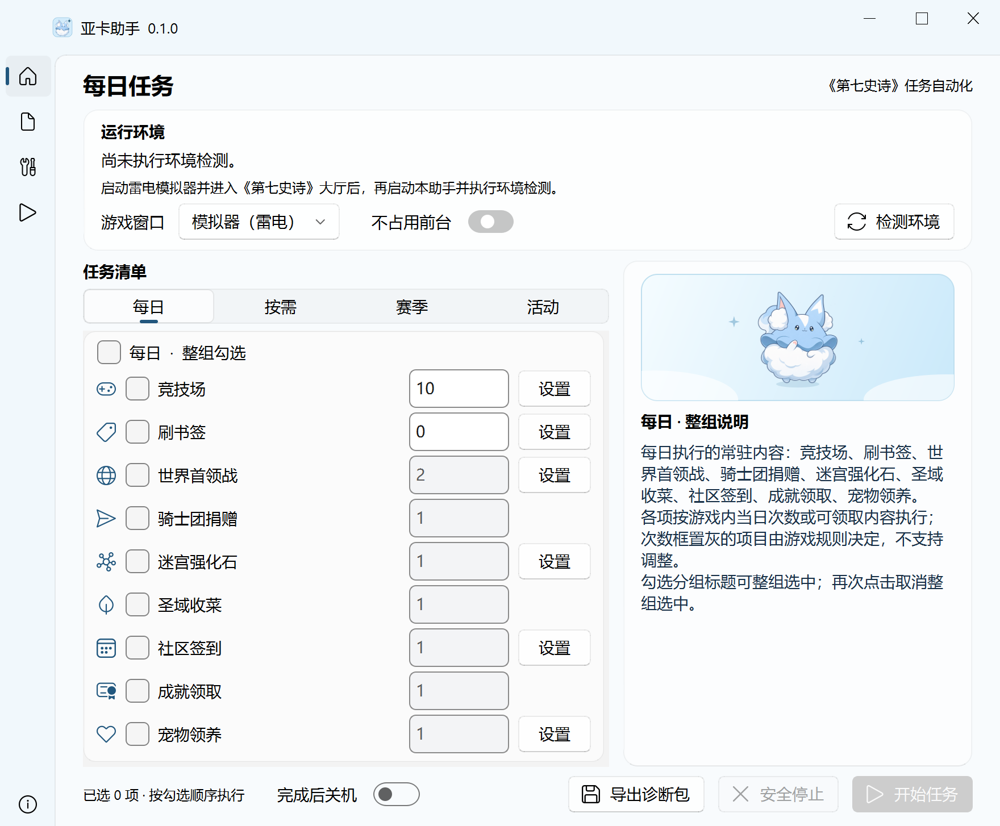
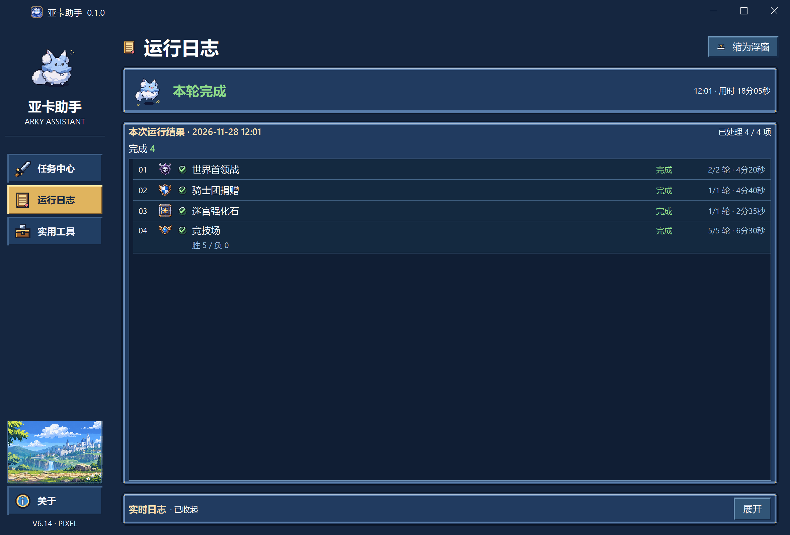

<div align="center">


# 亚卡助手

**《第七史诗》自动化助手**

让重复的日常交给亚卡，把游戏的乐趣留给自己。

[](https://github.com/Kangkangnice/epic7-automation/releases)
[](LICENSE)
[](https://github.com/Kangkangnice/epic7-automation/stargazers)

[快速开始](#快速开始) · [项目特色](#项目特色) · [界面预览](#界面预览) · [使用手册](docs/USER_GUIDE.md)

</div>

亚卡助手是一款免费开源的《第七史诗》国服自动化助手，支持 PC 客户端与安卓模拟器，帮助玩家轻松处理日常任务、资源获取、剧情推进及重复养成操作。

## 项目特色

### ☕ 轻松省心

- **日常减负**：减少繁琐的重复操作，适合时间有限的上班族和不想手动清理日常的玩家。
- **刷新提醒**：自动记录支线故事刷新倒计时及月光剧场免费观览状态，减少周期性任务和免费资源的遗漏。
- **进度可视**：通过悬浮窗口查看任务进度，运行结束后提供详细的结果统计。
- **便捷挂机**：支持 QQ 消息通知及自动关机，无需时刻守在电脑前。

### 🎯 灵活自由

- **自由编排**：按需组合任务，自定义执行顺序，既可一键清理日常，也可单独执行指定任务。
- **个性化设置**：支持运行次数、竞技场对手偏好、资源消耗等设置，适应不同玩家的游戏习惯。
- **任务接续**：部分任务支持从当前游戏页面继续执行，中途打断后无需从头再来。

### 📦 功能丰富

- **日常任务**：涵盖竞技场、世界首领战、骑士团捐赠、社区签到、迷宫强化石、圣域收菜等日常内容。
- **多样玩法**：支持刷书签、主线推进、支线故事、月光剧场、远征、月塔、装备制作及批量养成等多种游戏场景。

### 🖥️ 广泛兼容

- **多端适配**：支持 PC 客户端及安卓模拟器，目前已适配雷电、MuMu 模拟器。
- **非前台运行**：游戏窗口无需始终置顶，可在运行任务的同时使用电脑。游戏窗口需保持打开，不可最小化；PC 客户端部分操作仍需使用前台或鼠标。

## 界面预览



<details>
<summary>查看运行日志与结果示例</summary>



</details>

完整任务清单及各客户端的支持情况见[现状速查](docs/STATUS.md)。

## 快速开始

### 下载与运行

目前已公开源码，尚未发布 Windows 免安装包。正式发行后，可在 [GitHub Releases](https://github.com/Kangkangnice/epic7-automation/releases) 下载压缩包，解压后运行 `ArkyAssistant.exe`。

<details>
<summary>从源码运行（适合有 Python 基础的用户）</summary>

安装 Git 和 Python 3.13，在 PowerShell 中执行：

```powershell
git clone https://github.com/Kangkangnice/epic7-automation.git auto_game_unified
py -3.13 -m venv auto_game_unified\.venv
.\auto_game_unified\.venv\Scripts\python.exe -m pip install -r auto_game_unified\requirements.txt
.\auto_game_unified\.venv\Scripts\python.exe -u -m auto_game_unified.desktop
```

请保留仓库目录名称 `auto_game_unified`，并在其父目录执行上述 Python 命令。

</details>

### 使用方法

1. 启动游戏并进入大厅，打开亚卡助手。
2. 选择对应客户端，点击「检测环境」。
3. 按希望的执行顺序勾选任务，检查右侧的执行计划、次数及资源设置。
4. 点击「开始任务」，即可自动执行。

运行环境为 64 位 Windows，游戏使用简体中文。模拟器需启用 ADB、保持横屏 1920 × 1080 并单开游戏；PC 客户端按环境检测提示操作。特殊任务的启动页面及详细设置见[使用手册](docs/USER_GUIDE.md)。

## 使用须知

- 开始前请确认任务设置及资源消耗上限，尤其是涉及购买、合成、装备整理等操作的任务。首次使用建议先小范围试跑。
- 运行异常或发现操作不符合预期时，请点击「安全停止」或按 `P` 键，核对游戏状态后再继续。

刷书签的刷新次数默认是 0，仍会扫描当前货架并按设置使用金币购买目标商品。遇到扣费或回执不明时，先安全停止并核对游戏内余额和商品状态。详见[刷书签消费与对账](docs/USER_GUIDE.md#刷书签消费与对账)。

## 帮助与反馈

- 不清楚怎么使用？查看[使用手册](docs/USER_GUIDE.md)。
- 遇到运行问题？查看[故障排查](docs/TROUBLESHOOTING.md)，或通过 [Issues](https://github.com/Kangkangnice/epic7-automation/issues) 反馈（建议附上日志或脱敏截图）。

欢迎参与开发与贡献，详见[贡献指南](CONTRIBUTING.md)和[项目文档索引](docs/README.md)。

## 免责声明

本项目为个人维护的非官方开源工具，仅供学习与交流，与游戏开发商及运营方无关。使用第三方辅助工具可能违反游戏服务条款，存在账号处罚及资源损失风险，请自行了解相关规则并承担使用风险。

原创代码采用 [MIT License](LICENSE) 开源，游戏素材与第三方组件的权利及许可见[素材声明](NOTICE.md)。日志和诊断文件默认保存在本机，QQ 通知需主动配置，程序会查询 GitHub 发行版本以提供更新提示。隐私及安全反馈说明见[安全政策](SECURITY.md)。

---

<div align="center">

如果亚卡助手对你有帮助，欢迎点亮右上角的 ⭐ **Star**。

感谢每一位使用、反馈和参与开发的玩家！

</div>
