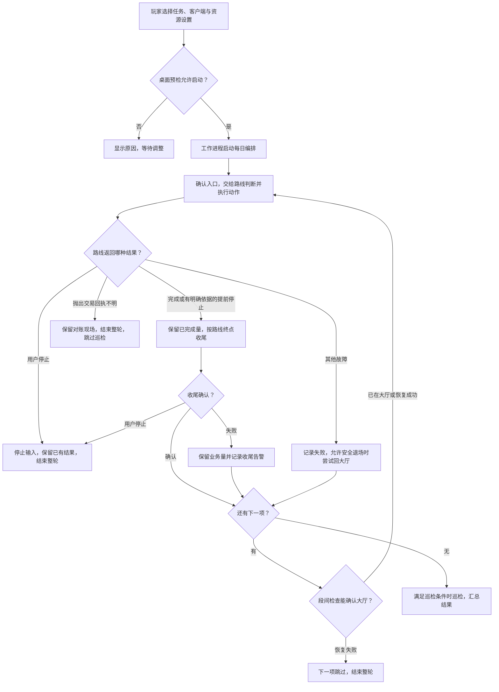

# 架构说明

## 桌面任务生命周期



- [桌面控制器](../desktop/controller.py)负责预检和请求，[工作进程](../desktop/worker.py)启动选定计划并接收停止请求。[任务入口](../main.py)组装运行通道、导航和路线，调用[每日编排](../games/epic7/daily_tasks.py)。
- [路线注册表](../games/epic7/modes.py)决定入口和接力范围，路线根据游戏画面决定动作与完成条件，共享执行器和 [Runtime](../core/runtime.py)负责输入、转场、停止和日志。[路线终点与回大厅](maintenance/route_finish_points.md)
- [任务入口](../main.py)把业务量与收尾告警分别放进结果。收尾时收到停止请求，编排先登记已有完成量再结束整轮。常规收尾失败后，下一项只有在段间检查确认大厅时才能执行。社区兑换和竞技场购旗抛出交易回执不明时，编排停止整轮。刷书签当前把回执超时报作普通故障，走图中「其他故障」。[刷书签异常处置](maintenance/shop_refresh.md#异常与收尾)
- 回归入口为[桌面启动与停止](../tests/test_desktop_controller.py)、[段间准入和结果保留](../tests/test_daily_tasks.py)、[收尾失败](../tests/test_home_return_failure.py)与[社区交易](../tests/test_community_redeem_receipt.py)。

## 目录职责

```text
auto_game_unified/
├─ core/
│  ├─ matcher.py            # 限定区域、缩放感知的 OpenCV 模板匹配
│  ├─ runtime.py            # 截图、点击、中文日志、当前帧和失败诊断
│  ├─ supervisor.py         # 两帧稳定、画面变化、状态轮询和超时监督
│  ├─ battle_supervisor.py  # 战斗监控：心跳、画面变化进展、结算移交
│  ├─ recovery.py           # 战斗锁：已承诺战斗期间禁止打断（只有 lock/unlock）
│  ├─ hotkey.py             # 全局停止键（P）—— 自动化与连点器共用同一个键
│  ├─ autoclicker.py        # 固定点连点器（「实用工具」页；与路线无关，不认画面）
│  ├─ qqbot.py             # 官方 QQ 机器人开放平台 C2C 私聊推送
│  ├─ window.py             # 模拟器窗口捕获与局部坐标点击（统一走标准 ADB，不认品牌）
│  ├─ emulator_adb.py       # 通用 ADB 后端：按游戏 PID 发现设备、screencap 取图、注入输入（新增模拟器零改动）
│  ├─ pc_window.py          # PC 客户端窗口 I/O（BitBlt 后台抓屏、SendInput 点击、ESC、滑动、滚轮）
│  ├─ visual_evidence.py    # 通用模板判据、动作证据及校验
│  ├─ evidence_diagnostics.py # 失败诊断落盘（screen/source/target/evidence.json）
│  ├─ elevation.py          # UIPI 提权判断（对方窗口权限更高时点击会被静默拦掉）
│  ├─ portrait.py           # 竖屏通道（H5 网页把模拟器切成竖屏时的取图与坐标）
│  └─ data_paths.py         # 运行产物（日志/诊断/导出）目录
├─ games/epic7/
│  ├─ navigation.py         # 从支持页面受控返回大厅并进入目标模式（导航链的**执行器**）
│  ├─ navigation_plan.py    # 导航链的声明式数据（纯 dataclass，不含任何路线知识）
│  ├─ global_popups.py      # 全局弹窗守卫（现行 20+ 类，清单见 POPUP_KINDS）
│  ├─ route_contract.py     # 路线级最低声明（终点/覆盖层/空态/回执/危险动作）与纯校验
│  ├─ unknown_screen.py     # 未知画面观察（只记诊断、交还上层）与大厅观赏模式的有界唤醒
│  ├─ battle_controls.py    # 战斗内 Auto/加速按钮识别
│  ├─ stamina.py            # 体力弹窗共享：区域、模板、补体力决策
│  ├─ runner_base.py        # 同构模式公共主循环（ModeRunnerBase；点一次→每帧重问状态机）
│  ├─ transactional_runner_base.py  # 事务型公共主循环（目标页连续两帧才提交状态）
│  ├─ template_paths.py     # 平台差异的**唯一入口**：共享图 / pc 同名图覆盖
│  ├─ 各路线模块            # 页面语义、动作和完成条件。注册表见 modes.py
│  ├─ daily_tasks.py        # 每日连打的**编排**（不是一条路线，不占 --mode）
│  ├─ modes.py              # 模式注册、默认状态、构建器、准入表态
│  ├─ evidence/             # 各路线视觉证据：模板、区域、阈值和页面组合
│  └─ templates/            # 线上识别使用的局部模板（pc/ 子目录是平台覆盖）
├─ desktop/                 # 与界面无关的业务层：控制器、路线文案、会话、worker、预检
├─ desktop_qt/              # 桌面界面（Qt / Fluent，**唯一交互入口**）
├─ tools/                   # 现状页生成、门禁检查、采图、打包、文档体检等开发工具
├─ tests/
│  ├─ fixtures/             # 当前客户端完整页面回归截图
│  └─ test_*.py             # 页面、动作、循环、超时和反例测试
└─ main.py                  # 通用 CLI、Runtime 和导航器组装
```

## 分层边界

一次操作的数据流为：

```text
游戏窗口截图
  → 路线视觉证据清单（模板、区域、阈值、页面组合）
  → 全局导航或模式状态机
  → 在限定区域匹配当前状态允许的锚点
  → 返回具名动作和窗口局部坐标
  → Runtime 记录日志并点击一次
  → 重新截图并验证目标页面
```

- `Epic7Window` 只负责找到、前置、截图和点击游戏窗口。
- `Runtime` 只负责执行能力、日志、停止键与诊断文件。
- 状态机只根据当前截图决定唯一允许动作，不直接点击。
- `games/epic7/evidence/` 是 UI 易变配置的唯一维护入口；状态机不再重复保存已迁移路线的模板路径、区域和阈值。
- Runner 负责两帧稳定、转场验证、重试、心跳、恢复和超时。
- `Epic7Navigator` 只负责大厅恢复和进入模式，不处理模式内部业务。

这些职责不能混在一起。点击成功不等于页面已经变化；内部状态只能在目标页面得到确认后继续。

`core` 持有公共窗口、匹配和证据类型，供游戏层、命令行和桌面组装。游戏层在
`games/epic7/evidence/` 声明业务锚点；旧 `evidence/common.py` 保留已有导入路径。
共享核心直接导入游戏和桌面模块会触发离线依赖门禁。

路线的正式名称用于日志、验收和进度匹配，来源为模式注册表。桌面界面与现状页使用展示名称，可附「国服」和「已过期」等备注。

### 共享视觉的演进顺序

1. 按[跨端共享视觉契约](decisions/0009-universal-vision-contract.md)统一截图口径、限定区域的文字证据、
   当前帧落点和拒绝依据。先把试点接到一条路线的正常 CLI 与桌面入口，再用未参与校准的路线验收公共策略。
2. 以 `ModeSpec`、`NavigationPlan` 和现有 Runner 分工复用业务语义，逐个证明旧平台覆盖可退出。
   每次变更独立回归，并按[接入指南](PC_TEMPLATE_MIGRATION.md)登记真实变体或例外。
3. 后续将 `main.py::run_mode` 的装配边界和桌面进度事件分别梳理。当前桌面部分进度由
   [run_progress.py](../desktop/run_progress.py) 解析日志。引入结构化事件时应同时核对进度、停止、
   结果和现有 CLI 行为。打包的源码保留约束及烟测入口见[发布手册](howto/release.md)。

## 坐标和窗口

状态机看到的是《第七史诗》窗口的局部 RGB 图像，不是整个桌面。模板和搜索区域以 `1982 x 1132` 为参考尺寸。

- 窗口在桌面移动时，局部坐标不变；点击前再加上最新窗口偏移。
- 窗口等比例缩放时，模板和区域同步缩放。
- 横纵缩放比例不一致时安全停止，防止坐标漂移。
- Windows DPI 感知在导入截图和鼠标库前启用，避免逻辑坐标与物理像素混用。
- Codex、桌面或其他窗口不属于游戏窗口截图，不能成为业务模板来源。

## 观测和动作确认

普通动作需要同一页面和动作连续两帧一致。执行一次点击后，Runner 继续截图，直到目标状态满足稳定条件才算转场完成。

- 动作重试额度由 Runner 明确控制并写入日志；`ModeRunnerBase` 当前上限为四次，独立 Runner 需单独审计。
- 上限用尽后，给路线**一次**原地「换个办法」的机会（`_self_heal_used`）：换成了别的动作就照常点，
  换回来还是同一个动作就直接安全停止。⚠️ 这**不是**点击额度的重置 —— 同一个动作一共只点四次。
- ⚠️ 2026-09-26 用户拍板：**回家就是结束**，程序不会再回大厅重新导航接着跑。
  「首次耗尽 / 状态超时 ⇒ `recovery()`（回大厅重开）⇒ 接着跑」整套已删除，改为直接安全停止
  （回家由 `main` 收尾）。**连带清掉的死零件**：`runner_base` 的 `recovery` 回调与
  `_apply_recovery_state` 钩子（含 6 条路线的覆写）、`main` 的 `recover_to_mode` /
  `report_blocked_recovery` / `runner_options["recovery"]`、`core/recovery.py` 的
  `recover()` / `RecoveryBlocked` / `on_blocked`、`ArenaStateMachine.reset_after_recovery`。
  剩下的那个闸门**只有**「已承诺战斗期间禁止打断」一个职责（见 `core/recovery.py`）。
- 结论门槛：收工 / 认不出画面这类**终止性结论**同样要连续两帧一致才采信，
  不能一帧就宣布整条路线结束（规矩见 [页面转场契约](TRANSITION_CONTRACTS.md)「结论门槛（全局强制）」）。
- 未知页面不能盲点业务按钮。

英雄合成动作已经携带来源页面、允许目标页面、原因和转场类型；**2026-11-09 审计后只剩狗粮**没补齐这些字段（`FodderAction` 仍只有名字与坐标，登记在 `modes.TRANSITION_EXEMPT` 的已知欠债里），其余路线要么已填、要么走各自的事务型基类。后续统一时以 [页面转场契约](TRANSITION_CONTRACTS.md) 为准，审计状态见 [自动化稳健性待办](TODO.md)，不能把当前部分实现写成所有路线已经完整具备。

加载和战斗使用画面变化作为进展信号。战斗每 30 秒输出心跳；HUD 被技能动画临时遮挡时，只要画面仍是有效游戏帧且战斗区域持续变化，就继续监控。

## 循环完成定义

点击最后一个确认按钮不代表完成。只有重新识别到稳定入口时才增加 `completed_cycles`：

- 竞技场：回到对手列表。
- 主线：处理完剧情、奖励、好友申请和结算，重新出现下一关入口。
- 远征：回到远征主页并看到“我的通缉传单”。动态传单角标不参与识别。
- 狗粮：结算确认后重新出现“重新进行”；达到目标轮数时不点击该按钮。
- 英雄合成：模拟器翻卡通过右侧列表的“稳定→定向运动→重新稳定”动态证据确认，因此同名同外观副本也能安全推进；SSS、普通与未知使用三态分类，未知目标不点击。发现 SSS 材料后，传送事务会一直保留当前目标，只有奖励层联合证据稳定出现且返回英雄列表后才清理，防止漏传、误传或重复传送。

这样可以避免点击未生效、加载卡住或额外弹窗出现时产生虚假计数。

业务计数和收尾分别记录。若回首页未确认，`RunResult.closeout_warning` 会传到命令行和每日结果，
已完成的业务数量仍保留。收尾期间手动停止时，每日编排保留已完成的结果并结束本轮。
发布验收还需核对真实回执和约定终点，见[路线开发与验收](howto/route_change.md)。

## 同构模式公共骨架

`runner_base.py` 的 `ModeRunnerBase` 统一实现**同构线**的公共主循环，覆盖主线 `story` 与它的两个子类
（支线故事 / 活动剧情）、狗粮、英雄合成、骑士团捐赠、圣域收菜、迷宫强化石、月光剧场、世界首领战、
成就领取、社区签到，以及后续新增的宠物领养、企鹅批量购买、装备制作与主线补星。
逐条归类以 `modes.MODE_SPECS` 和类定义为准，本页不记条数。

- 空跑短路、两帧稳定确认、同动作 45 秒转场等待、4 次点击上限。**页内滚动这类本来就不换页的动作**可由路线登记进 `_REPEATABLE_ACTIONS` 豁免 4 次上限（名单默认空，老路线零影响）；主线补星横向翻篇章要连滚好几下才到头，2026-11-10 19:18 实跑正是撞了这条上限。
- 结论门槛（收工 / 认不出画面也要连续两帧一致）。
- 未知画面唤醒、结算等待与绝对超时熔断；动作循环检测与状态超时**直接安全停止**
  （不再「回大厅重新导航一次」）。

各模式只通过钩子注入差异：超时表、战斗移交方式（先点击再移交 / 战斗监督代点 / 停留战斗态直接移交）、战斗监控实现（`BattleSupervisor` 或自带循环）。

**另一族**是事务型的 `TransactionalRunnerBase`：竞技场、远征、月塔。它们的出口验收比
`ModeRunnerBase` 更严 —— 目标页连续两帧才提交，来源/目标契约缺任一直接 raise。
⚠️ 竞技场虽然继承它，但**保留自己的 `run()`**（循环策略与远征有 10 处实质差异），
所以它不走基类里那道「画面冻住就不补点」的闸门。

**完全自带主循环**的是两条：刷书签 `ShopRefreshRunner` 与活动小游戏 `SurvivorRunner`。
它们各自用 `_wait_stable` / `_observe_stable(page, timeout)` 验收，不经过任何基类。

## 全局弹窗守卫

`global_popups.py` 的 `Epic7GlobalPopupGuard` 在各模式轮询间隙统一处理全局弹窗，一次安装全模式共享。
**它早已不是四种弹窗的清单**：2026-11-09 核实时注册了 20 多类（断网、亲密度、友情点数、好友申请是
最早的四类，之后陆续加了支线故事通知、获得奖励、领取支援物品、账号 Rank、骑士团签到 / 支援 /
周奖励 / 成长 Rank、首领战支援奖励、段位升级奖励、战斗记录、新的每周排名、每周排名选择奖励、
宠物礼物、变更日期、登录奖励、网页网络错误、「无法控制」剧情、轻触解锁、跳过教学……）。
**别在这里手抄清单**——现行类别以 `_find_popup()` 里的分支为准，另有一组 PC 专属弹窗由
`install_pc_only_popups()` 挂上去。

下表只列最早那四类，**不是全集**：

| 弹窗 | 识别 | 处理 |
| --- | --- | --- |
| 断网重连 | 重试标题 + 重试按钮 | 点击重试，2 次未消失安全停止 |
| 亲密度提升 | 等级提升标题 + 关闭按钮 | 点击关闭，2 次未消失安全停止 |
| 友情点数 | 标题 + 关闭按钮 | 点击关闭，2 次未消失安全停止 |
| 好友申请 | 标题 + 取消按钮 | 点击取消，2 次未消失安全停止 |

新增全局弹窗时优先扩展守卫处理链，不在单个模式内加本地分支。
⚠️ 有一类**不能**交给守卫抢关：与路线自己同 UI 的通知层（如英雄合成的「传送奖励」、
骑士团捐赠的「支援成功奖励」），守卫抢先点掉会让路线的 `target_pages` 永远不成立 ——
这类用 `ModeSpec.reward_notice_guard` 按路线关掉。
体力不足弹窗是业务弹窗而非全局弹窗，由 `stamina.py` 统一决策（生命之叶补充 → 确认 → 耗尽安全停止）。

## 日志规范

所有日志使用中文键值对格式，从日志可直接判断当前模式和进程阶段：

```text
模式=狗粮 轮次=1/2 页面=结算确认 动作=replay_confirm 尝试=1/2
模式=主线 停止=生命之叶耗尽 详情=生命之叶已耗尽或生命之叶选项不可用
```

- 固定键：`模式`、`轮次`、`页面`、`动作`、`阶段`、`状态`、`停止`、`结论`。
- 页面名使用中文画面描述（如“队伍选择”、“结算确认”），不用 Enum 值。
- 停止原因必须写明业务含义（如“生命之叶耗尽”、“页面识别超时”）。
- 新增日志必须遵循同一格式，保证 grep 单个键（如 `模式=`）即可过滤整条链路。

改变页面或业务状态的日志还应区分“动作候选、执行点击、等待确认、转场确认、业务成功”。目标证据出现前不得输出业务成功；具体字段见 [页面转场契约](TRANSITION_CONTRACTS.md)。

## 远征特殊流程

远征固定使用三阶段：

```text
远征主页 → 我的通缉传单 → 卡片内远征队出发
→ 选择三阶段 → 确认 → 准备战斗 → 队伍战斗开始
→ 战斗 → 结果确认
```

首领存活时：

```text
公开招募 → 弹窗确认 → 萤火待机时唤醒 UI
→ 返回远征队列表 → 再返回远征主页 → 完成一轮
```

萤火待机只能点击中央安全区域，并要求真正 UI 出现；仍停留萤火页不算唤醒成功。卡片搜索区域排除右下角“所有远征队出发”，避免危险误点。

## 干跑状态诊断

进程不会持久化内部状态。`--start-state` 只用于干跑诊断，`modes.py` 会验证状态属于对应模式。实跑传入该参数会在截图和点击前拒绝。

正常实跑在开局会先做一次接力探测（见下节「开局接力」）；没命中接力点才通过导航器受控回大厅，再从大厅进入目标模式。尚未明确支持的中途页面不能靠手工状态参数强行实跑。

## 开局接力

`ModeSpec.resume_probe` 定义能否在启动时接手现有进度。探针返回页面标签、需恢复的运行状态，以及已处于导航链上的节点。没有探针时按声明从入口开始。起点范围见[开局接力覆盖面](RESUME_COVERAGE.md)。

`main._enter_mode` 在开局回大厅的过程中传入探针。稳定画面命中后立即保留现场。状态已确定时把控制交给路线，命中导航节点时用 `already_at` 从后续步骤继续。导航链和允许接手的节点由 `NavigationPlan.resume_entries` 及路线注册声明提供。

接力要辨认页面归属和状态优先级。通用的结算确认按钮可能在多条路线出现，买票弹窗底下也可能仍能认出队伍页。先识别可排除歧义的页面，再决定是否交给路线或战斗监督。实现和验证约束见[接力契约](TRANSITION_CONTRACTS.md#接力契约路线准入的另一半)。

## 模板和回归素材

- `tests/fixtures/` 保存完整游戏窗口，是问题的可重放证据。
- `games/epic7/templates/` 保存局部稳定锚点，是线上识别输入。
- 模板优先使用文字、图标和按钮轮廓，避免章节背景、角色立绘、动画和动态角标。
- 竞技场、主线、远征和英雄合成的视觉证据分别维护在 `games/epic7/evidence/`。当前 `tools/check_evidence.py` 支持竞技场离线检查；其他正式路线从实跑失败证据包定位失效键名。
- 背景变化大的控件使用专用颜色、边缘或区域算法，并配正例、变体和反例测试。
- 当前客户端未采集的页面应安全停止，不能拿旧客户端素材冒充支持。

详细采集规则见 [TEMPLATE_CAPTURE.md](TEMPLATE_CAPTURE.md)。

竞技场图鉴资产由 `hero_catalog.py` 提供桌面筛选分类，由 `hero_match.py` 识别已配置的避战和优先目标。
英雄合成使用 `templates/hero/` 的页面与控件判据。批量维护时用 `tools.check --plan` 从实际文件选定回归，
执行顺序见[游戏更新手册](howto/game_update.md)。

维护频繁、可用离线反例验证的独立行为，可按实际调用关系设立定向合并边界。首个实例是补星的篇章选卡；状态机消费候选结果并执行转场。边界的登记、升级全量与发布条件见[决策 0011](decisions/0011-behavior-based-regression.md)。

## 视觉证据诊断

正式路线失败时保留原有 `时间戳_原因.png`，并在同名无扩展名目录中追加：

```text
时间戳_原因.png
时间戳_原因/
├─ screen.png           # 最终全屏（与外面那张同源）
├─ source.png           # 来源页裁剪（有来源区域时才有）
├─ target.png           # 目标页裁剪（有目标区域时才有）
└─ evidence.json        # 动作 / 来源 / 目标 / 尝试次数 / 逐锚点分数 / 结论
```

`evidence.json` 记录证据配置文件、模板路径、搜索区域、参考尺寸、实际分数、阈值、是否命中、中心点和页面结论。低于阈值的模板仍保留数值分数，便于区分“差一点”“区域错误”和“模板完全失效”；只有可选模板文件不存在时分数才是 `null`。`config` 字段就是 UI 改版时应优先修改的位置。

复杂页面不能在检查器和生产状态机中各写一套规则。竞技场的对手选中页及普通/快速战斗页通过共享 evaluator 分类；改判定时必须同时回归生产状态机和检查器输出。

## 日志、资源和故障

终端和滚动文件日志记录模式、轮次、页面、动作、重试、等待、恢复和停止原因。只保留当前监控帧，失败诊断按上限轮换，避免内存和磁盘无限增长。

已定义的资源耗尽返回退出码 `2`；未知页面、黑屏、转场失败或绝对超时返回 `1`；P 键停止返回 `130`。故障定位流程见 [TROUBLESHOOTING.md](TROUBLESHOOTING.md)。
