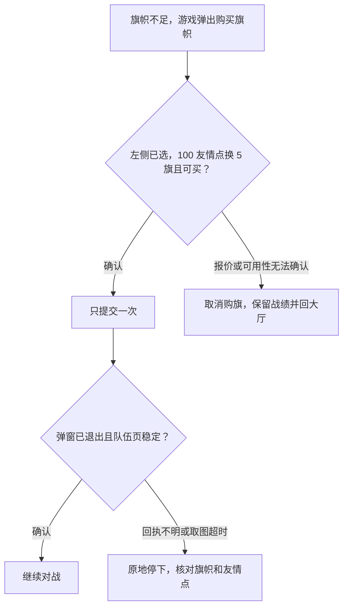

# 竞技场 arena · 业务契约

从大厅进入竞技场，按设置选对手。结算并回到对手列表后计入场次。跑满场次或旗帜无法安全补充时保留战绩并回大厅；购旗结果不明时留在原处等对账。[现状与实机范围](../STATUS.md)

## 这条路线在游戏里干什么

每天打若干局竞技场：进模式 → 选对手 → 打 → 结算 → 记战绩 → 回对手列表继续下一局，
打满次数或票耗尽就收工回大厅。每局把「胜 / 负 / 未知」累计进汇总与通知。
**这条路线会花资源**（旗帜、开战券），购买与刷新受下面「危险边界」约束。

## 页面链路

```
竞技场模式选择 → 对手列表 → 对手详情 → 战斗 → 战斗结果 →（段位提升 / 升级奖励）→ 对手列表 …
```

- 每周第一次进场会弹「新的每周排名开始！」，关掉后紧跟「每周排名选择奖励」。
- 旗帜耗尽点「开始战斗」弹「购买旗帜」；点「刷新对手」弹「更新交战对手」确认窗。
- 这些弹窗由**全局弹窗守卫**处理，**不是**竞技场状态机里的页面（理由见下节）。

## 判据为什么这么设计

每条写的是「靠哪一维排除外观同类、语义不同的对象」，不是调阈值的经验值。

- **模式选择入口 `novice_arena`**：按钮名字（新手期「新手竞技场」/ 之后「竞技场」）
  和上半截（赛季提示 / 段位徽章＋段位字）**都会变**，只有底部标题那行字形每次一样。
  ⇒ 模板只裁那一行字形；两种长相走多候选（任一过阈取最高分）。锚点名是历史遗留，
  现在指「这个入口按钮」，**不特指新手期**。量分必须走 `Epic7Navigator` 的生产口径 RGB，
  用 BGR 直喂会凭空掉分。反向护栏在 `tests/test_navigation.py -k arena`；
  不要改 `_locate()` / `_assert_anchor_templates()`（它们早已支持多候选并拦「整组为空」）。
- **大厅入口 `lobby_arena`**：按钮上方会被游戏挂一条蓝色 EVENT 标（活动期挂、结束撤）。
  旧模板把上方一片背景裁进去，标一挂就整页认不出。改法是**全宽保留、只去掉上部**，
  **不是**裁成纯字形 —— 纯字形会让底纹更淡的动画帧掉到阈下。这个裁法是
  「挂标帧 + 动画帧」同时过阈的唯一一档，不要退回整钮模板。
- **全局弹窗一律双锚点**：标题是**排他判据**，底部「点击关闭」只给点击点、**不排他**
  （那行灰字是游戏通用控件，单独用会在别的领奖弹窗上误命中，有专门的反向用例钉着）。
  每周排名那层的标题更高、按钮更低，两块 ROI 必须单独定，别照抄别的层。
- **为什么弹窗修在守卫而不是竞技场状态机**：守卫挂在 `runtime.capture` 上，每一帧都过，
  包括「等待转场」循环；放守卫里任何路线撞上都能自愈，放进某条路线其它路线照样卡住。
- **每周排名「选择奖励」点一下关不掉**：守卫要返回「这一次该点哪里」——领取按钮文字
  灰就先点奖励卡片，变白再点领取。**默认选钻石是用户拍板的业务口径**，不是代码猜的。
  2026-11-16 起做成可选项 `weekly_reward`（`diamond` 默认 / `mystic`）：两张卡并排，
  点哪张由路线选项决定；要的那张认不出来就返回「没认出」，**绝不退回另一张** ——
  一周只能领一次，领错就没了。两张模板交叉分数 0.3273，卡片搜索区必须同时罩住两张
  （只罩左边时右侧模板根本搜不到）。
- **每周对战奖励靠红点证伪，不靠图标或次数文字**（2026-11-17 接，11-18 订正）：
  奖励宝石位于对手列表左侧、「配置防御队」上方。11-17 那张"宝石图标"模板实际裁的是
  标题右侧会变的次数文字 `(1/3)`，命中点落在文字上、距宝石中心 74 像素，真机点了
  33 秒红点一动不动（11-18 当日唯一一处失败）。现在只保留两维：
  **标题**做页面定位（三帧都是 1.0000）、**红点**做可领判据（整颗 241 像素 / 领完 0）；
  点击点由标题中心 + 固定偏移 `(204, 8)` 给出，正好落在亮宝石图案上。
  宝石本体不能当判据 —— 可领是亮蓝、领完变暗，两态差距大，不可比。
  红点搜索区 `(265,644,45,40)` 四边留余量：旧区域只盖住红点左半边（146/241），
  圆心离边界只剩 1 像素，界面横移几像素就整颗漏掉。
  领奖排在选对手之前，是同页动作：点击后等红点连续两帧消失才置「本轮已检查」，
  没消失就留诊断安全停止，**不连点第二下**。该动作与每周排名选奖是两件事，
  前者即时领取、没有确认弹窗，后者走全局弹窗守卫。
  ⚠️ 遮罩误判已修（2026-11-18 现场，11-26 补判据）。领取时若弹出「与服务器的连接已中断」
  全屏遮罩，红点被压暗成 0 像素，只看红点会误判成"已领完"——11-18 08:43 真机踩中：
  点后 1.5 秒红点仍在、3.5 秒弹遮罩、随后红点读数 0，但奖励未入账（09:11 复测才真正领到：
  次数 2/3 → 3/3、天空石 +50）。
  **为什么不用整屏亮度**：断网帧整屏均亮 11~18，而正常弹窗帧（购买 / 每周排名 / 免费刷新）
  也在 17~35，两条分布重叠，绝对亮度门会误伤正常弹窗，需逐显示器标定。改用两维页内判据，
  都不动红点阈值：① **标题白字**（`weekly_reward_title_bright_pixels`，取「每周对战奖励」
  标题区低饱和 V≥180 像素）—— 可领 / 已领帧 131 / 161px，压暗帧与断网帧均为 0px，
  阈值 60 有余量；② **断网文案**（`find_network_retry`，与全局守卫共用模板根）——
  真机断网帧 0.9992，全库 218 张非断网帧最高 0.5543。等待器要求「列表 + 红点<60 +
  标题白字≥60 + 断网文案缺席」连续两帧才置已检查；任一维不成立只写「结论待确认=画面不可读」
  并继续等，不重试点击（清障交给全局守卫），超时保存诊断安全停止。
  回归在 `tests/test_arena_evidence_guards.py`：压暗帧、11-18 等价现场帧（可领列表 +
  红点局部压暗 + 断网文案叠加）均不得判已领，正常已领帧照旧通过。
  **仍待验**：11-18 那份真机遮罩帧未入库，离线用等价帧回放；下次周奖刷新需实机核一次
  「清障后红点重新读数」的完整链路。
- **对手偏好只排序、不否决，积分读不出就说读不出**：行上能读的只有积分与「能不能打」，
  这一页没有总战力（对手详情页也没有）。偏好用 OCR 读整列三行（一次约 0.4 秒，
  区域与基线实测见 `games/epic7/arena_points.py`），只认**以「积分」开头**且垂直位置
  贴近某一行基线的框 —— 昵称里出现「积分」二字不会被当成读数。读不出的那一行返回
  `None`，不拿 0 顶替；三行都读不出就退回原来的随机挑选，并在动作依据里写明
  「对手偏好未生效」。**偏好不改判据**：能不能打仍由红色像素比的三态判定说了算，
  两者互不替代。读数每页只跑一次（空跑那一趟读过就复用），列表换批时作废。
  读数是可选依赖（`rapidocr-onnxruntime`），没装则整段不启用，主流程零影响。
- **英雄名单靠 ORB 认头像，不靠模板匹配**：图鉴头像与竞技场头像的渲染（色调、光照）与尺度都不同，
  `TM_CCOEFF_NORMED` 在这类图上**基线过高**——库内不同英雄之间相似度中位数就有 0.914，
  正确答案反而被淹没（实测正确 0.891 还不如随便挑一个别的英雄）。改用 ORB + RANSAC，
  四个条件同时满足才算命中：good ≥ 40、内点 ≥ 30、第二名 good ≤ 第一名/3、
  **单应变换后中心区域的相关 ≥ 0.80**。
  **不能用绝对分数定阈**：不同英雄能提的特征点数差一倍（468~1049），必须配相对优势条件。
  **相关只算中心 50% 区域，不算整图**（2026-11-17 改）：图鉴库的图是方形带边框与角标，
  换成外部图鉴的圆形裁切后四角内容毫无关系，整图相关会被这些边缘拖到 0.3 附近
  （实测同一英雄同一帧：本地图 0.77、外部图 0.32）；只取中心后两种图源分别是
  0.92~0.99 与 0.95~0.99，而错误英雄的中心相关最高 0.645、内点最高 7，
  正确样本内点 98 起 —— 取中心不是放宽，反而更容易证伪，阈值因此从 0.60 提到 0.80。
  实机复测：七个有头像的槽位，本地图与外部图各自 7/7 命中、结论完全一致。
  弱证据必须被拒：同一页有一格实测 good=15 / 内点 14 / 相关 0.55，判「认不出」而不是猜名字。
  名单只加载被点名的英雄（不是全库 389），一页 12 个头像的识别在秒级；同一帧只识别一次
  （主循环每秒都问，重复识别会拖慢整条路线），画面像素不变就复用上次结论。
- **优先名单是「优先开战」，不是「只打」**（2026-11-15 用户纠正，此前实现按「只打」写错过一次；
  界面在 2026-11-17 由「白名单」改名为「优先名单」，原因就是「白名单」容易被读成「只打这些」）：
  命中优先名单的行单独成组、排在最前，**但一个都没有命中的页照样打**，只是退回常规挑法（按积分）。
  组内**先比命中数**（命中两名英雄的队比命中一名的更想打），命中数相同的再按积分偏好。
  写成「只打」的后果是：开了优先名单却一次没撞上就整页无人可打，只能反复刷新直到收工，与意图相反。
- **避战名单是唯一的否决，两份名单都命中时按选项处置**（2026-11-25 用户拍板取消数量比较）：
  只命中避战名单出局、只命中优先名单进优先组、两份都命中则看「两份名单都命中时」选项
  （默认按避战名单处理）。不再比命中数量 —— 用户原话「不用比黑白名单的数量，直接比你的规则」。
  一行四个头像全认不出时按「两边都没命中」处理，进普通组 —— 认不出不是排除的理由。
  **同一名英雄只会留在一份名单里**：界面勾进一边就自动从另一边移出，避免同一名英雄既被要求避战、
  又被要求优先，语义自相矛盾。
  **整页都被否掉时不许硬打**：刷新（只点免费那一档，付费弹窗压根不认），连续若干页仍无可挑战行即按
  资源耗尽通道正常收工（`NoEligibleOpponent`，stop_label「名单条件下无对手」），并在日志里点名跳过了哪一行、为什么。
- PC 与模拟器共用随包分发的英雄图鉴。配置名单中缺图的英雄会记录「图鉴缺图（认不出，未生效）」。[英雄图鉴维护](hero_roster.md)
- **名单界面按游戏内英雄管理的口径分类**（2026-11-17）：顶部分属性（火/水/木/光/暗）、
  职业（战士/骑士/盗贼/射手/魔导士/精灵师）、星级（5/4/3）三组**可多选**按钮，主体是头像网格，
  点击头像即勾选（圆形头像 + 蓝色圆环 + 蓝字），已选的英雄在**打开对话框与改变筛选条件时**排在最前；
  勾选当次不重排，否则刚点的格子会从指尖跳走，连续勾选尤其难用。
  分类数据在 `templates/arena/heroes_pokedex/meta.json`，**按头像与公开英雄库逐一比对建立，
  不按名字对齐**——图鉴库的名字来自图鉴页识别，存在错字（实测库内名为「岚」的头像实为 Ken、
  「亚敏」实为 Aki），按名字对齐会整批串行。建表判据：RANSAC 内点 ≥ 20 且 ≥ 2 倍第二名，
  低于门槛的一律不进表。
  表里没有的名字按「未收录分类」处理：仍然列出、可勾选、可搜索，只是不参与分类筛选；
  界面底部如实显示未收录数量，不隐藏也不猜一个分类。
  **有搜索词时分类条件不生效**（三组按钮同时置灰）——否则搜一个未收录分类的英雄会得到空结果，
  看起来像库里没有这个人。
  **分类表是快照**。新英雄、改名或修订分类按[图鉴维护](hero_roster.md)处理，入库前跑离线一致性检查。
  竞技场识别只加载已配置的避战和优先目标。
- **PC 字形与同名反例**：历史覆盖图用于保全已验收路径。全局低通曾把迷宫、商店内同名的
  「购买」弹窗一起抬过阈。后续采用[共享视觉接入规则](../PC_TEMPLATE_MIGRATION.md)，先用来源页、
  交易语义和布局区分同名按钮，再核对当前帧中的按钮状态。
- **遮罩会反转判据，比「认不出」更危险**：「更新交战对手」是半透明模态框，底下对手行
  被压暗，而「能不能打」靠行内红色像素占比 ⇒ 压暗后三个不可挑战的对手全被判成可打；
  而 safe_list 判定排在弹窗处理之前，弹窗就永远轮不到点。现有 `_wait_until_safe_list`
  需保留确认窗在场时屏蔽列表的否证。
  ⇒ 通用结论：**凡判据依赖会被遮罩盖住的那块画面（状态色、血条、数量角标），都要问
  「遮罩压上来它会变成什么」**。补图只解决认不出，解决不了「认出了错的结论」。
- **竞技场有两个页签：交战对手 / NPC对战**（2026-11-16 接）。它们是同一页的两种列表，
  后面的选行、挑战、队伍选择、结算**完全一样**（逐帧核对：选中一行后两颗判据分数
  0.9552 / 1.0000，两边逐位相同；NPC 页三行"能不能打"也全是 True）。差别只在入口：
  * 进竞技场先看是不是停在「NPC交战对手」页上（标题模板 `arena_npc_title.png`，
    NPC 页 1.0000 / 普通列表 0.3898 / 队伍选择 0.2141）；停在那儿就先点一次右菜单
    「交战对手」，把默认拉回玩家对战 —— **一场只试一次**。
  * 结算日该页签变灰点不动：点完画面仍是 NPC 页，而 NPC 页本身也满足列表判据，
    于是转场照样成立，路线直接按 NPC 页打。这就是「点不动就退回 NPC」，不需要
    识别"灰"这个外观，也就不依赖结算日才能拍到的样张。
  * 顺带修掉一个坑：竞技场会**记住上次停在哪个页签**。以前若上次停在 NPC 页，
    下一次开局会落在 NPC 页上；现在有这一步，行为稳定。
  * **2026-11-21 起页签由用户选**：路线设置里的可选项 `opponent_source`（界面标签
    「对手来源」）取 `player`（默认，等于上面这套口径）或 `npc`。选 `npc` 时反向对齐：
    停在交战对手页就先点一次右菜单「NPC对战」，落点 `(1661, 378)`（由
    `tests/fixtures/epic7_arena/npc_list.png` 实测，与交战对手同行距 150px）。
    两边都是**一轮只点一次**，点不动就按当前页签继续，不反复点。
  * **2026-11-24 补：游戏也可能记住「非对战页签」**（当次落在「战斗记录」）。此时
    没有 `list_ready` 也没有 `novice_arena`，导航器整页判 unknown，「只等」3 分钟后
    报「进入竞技场失败」—— 上面那套页签对齐在 Runner 里，导航没过根本轮不到它。
    修法在导航层（`navigation._recover_arena_wrong_tab`）：只在「竞技场模式选择 →
    对手列表」这一步，用左侧「每周对战奖励」标题（全枢纽页都有，1.0000）认出
    「人在竞技场、站错页签」，与两个对战锚点缺席组成合取判据，按 `opponent_source`
    点回所选页签；两次不成功即报错留诊断。正例夹具
    `tests/fixtures/epic7_arena/arena_other_tab_live_20261124.png`。
- **结算行要写清对手来源**（2026-11-16 用户要求）：`outcome_summary()` 前面加
  「玩家对战 / NPC 对战 / 玩家对战 + NPC 对战」，依据是选行那一刻所在页签
  （`machine.battle_kinds`）。局内接力进来的那一局不知道从哪个页签开的，
  **就不写这一段**，不猜。
- **战绩**：`observe_outcome` 用 VICTORY / DEFEAT 横幅判胜负，两个横幅共用同一块区域
  （同一把尺子）。`result_rating`（「积分」面板标题）在真机帧上只有约 0.38、阈 0.80，
  **已不适合作主判据**；代码里保留它只是最后一档回退，真机上不会命中，战绩实际只靠
  两个横幅。认不出时**单列「未知」，绝不并入「负」**。换这三张锚点必须跑
  `tests/test_arena_outcome.py`——接力用的页面是「三者之一」，单靠它分不出哪个坏了。
- **「未知」怎么来的、留了什么证**（2026-11-16 用户追问）：结算页刚确认那一拍横幅可能
  还在淡入，所以认不出时**连读三帧**（间隔 0.5 秒）；三次都认不出才入「未知」，
  同时把三颗锚点的真实分数写进日志（`战绩认不出 锚点分数 result_victory=… `）、
  并把当帧存成 `outcome_unknown_round<N>.png`。这样下一次出现「未知」时，
  是横幅没淡入、还是结算页换了皮、还是根本不是结算页，看分数与帧就能定性。
  这条**不违反**下面「结算帧不落盘」：那是每局都存，这里只在认不出时存一张。
- **每局结算帧不再落盘**（用户 2026-11-08 要求）：旧做法每跑一轮就往 git 历史加十来张
  全屏 PNG，是仓库变胖的主要来源之一。现在只在认不出 / 超时 / 手动停止这类真故障时
  由 `Runtime.save_diagnostic` 存诊断帧；战绩照旧记进汇总与通知。
- **自动开关点完要等目标确认**（2026-11-26 修，规则见 [TRANSITION_CONTRACTS.md](../TRANSITION_CONTRACTS.md)）：
  右下角四格底座是自动开启的正向判据，右上角自动关闭图标只是来源线索；图标消失不能推出自动已开。
  点击后 15 秒内即便又读到手动来源也不再拨开关，等底座连续两帧确认；窗口结束仍只有手动来源，
  才在四次额度内重试。四次额度、900 秒无业务进展看门狗均未改动。
  2026-11-26 竞技场第 7 场卡在 VS 入场帧 900 秒，日志显示 12:58:05 与 12:58:10 连点两下；
  11-11 同类现场在来源离开 5 秒后补点。统计脚本与结论保存在
  `runtime_logs/_measure_auto_confirm_gaps.py` 与 `runtime_logs/_auto_confirm_gaps.txt`。

## 危险边界

- **购旗前**确认游戏弹出了「购买旗帜」、选中的是左侧 100 友情点换 5 面旗、购买键可用。报价不可确认时保留已完成场次并退场。
- **购旗后**等待弹窗退出且队伍页稳定，再开始战斗。弹窗在前景时，即使背景的「开始战斗」看得见，也只能等。回执超时或读回执时截图超时，保存最后可靠画面并原地停止整轮。请核对游戏内友情点余额和旗帜数。游戏明确拒绝的分支仍待验证。
- **天空石购旗 / 金币刷新暂不支持**（2026-11-26 独立验收）：`skystone_ticket_offer.png`
  与 `arena_refresh_gold.png` 在模拟器和 PC 均不存在，开启后在报价判据处按证据不足
  安全停止。界面选项与 `docs/USER_GUIDE.md` 已标「暂不支持」；补齐报价、确认、回执
  与授权实机证据前不得改为可用。
- 「购买旗帜」弹窗出现时，监督循环冻结背景点击、交还业务处理，不许连点「开始战斗」。
- 认不出 / 超时 / 票耗尽 → 安全停止留证，不猜着继续点，见
  [TRANSITION_CONTRACTS.md](../TRANSITION_CONTRACTS.md)。
- 每周选奖判错方向是安全的（两个分支都不会领错奖励），但**不许把「默认钻石」改成自动择优**。
- 全局危险动作与拦截机制见 [SAFETY_MATRIX.md](../SAFETY_MATRIX.md) 第一节。

### 友情点购旗分支



实现由 [arena.py](../../games/epic7/arena.py) 识别报价和浮层，PC 遇到标题或取消键任一仍在便继续等待。[事务执行器](../../games/epic7/transactional_runner_base.py)在读取不可逆操作的回执超时时，以最后可靠帧留证，保留原始异常并抛出 `PurchaseReceiptUnclear`。回归重点是购买仅一次、背景队伍页被浮层遮挡和读回执超时。[购旗回归](../../tests/test_arena_purchase_popup.py) · [转场契约](../TRANSITION_CONTRACTS.md#模拟器竞技场示例)

## 现行事实（不写数字，链机器产出）

- 路线可用范围、次数、接力和验收状态见[现状速查](../STATUS.md)。
- 工作区模拟器的玩家与 NPC 对战记录，以及 11 月 27 日十场 NPC、购旗后续打和收尾的原始定位，见[竞技场桌面实机复核](../SAFETY_MATRIX.md#竞技场桌面实机复核)。
- 视觉证据与判据表：`games/epic7/evidence/arena.py`；业务状态机：`games/epic7/arena.py`。
- UI 改版怎么改（取证 → 换模板 → 区域 → 阈值 → 反例）见 [EXTENDING.md](../EXTENDING.md) §0
  与 [TEMPLATE_CAPTURE.md](../TEMPLATE_CAPTURE.md)；**不许为了过单张截图降阈值**。
- 全局弹窗的接触点与现行类别见 `games/epic7/global_popups.py` 与
  [ARCHITECTURE.md](../ARCHITECTURE.md)「全局弹窗守卫」，本页不写死类别数。

## 已知缺口

本页不列缺口。所有待验证项、历史遗留与待拍板事项统一登记在
[TODO.md](../TODO.md)「待验证 / 缺口登记」，按路线名可查；
发现新缺口请直接补进 TODO，不要往本页加一节事故记录。
