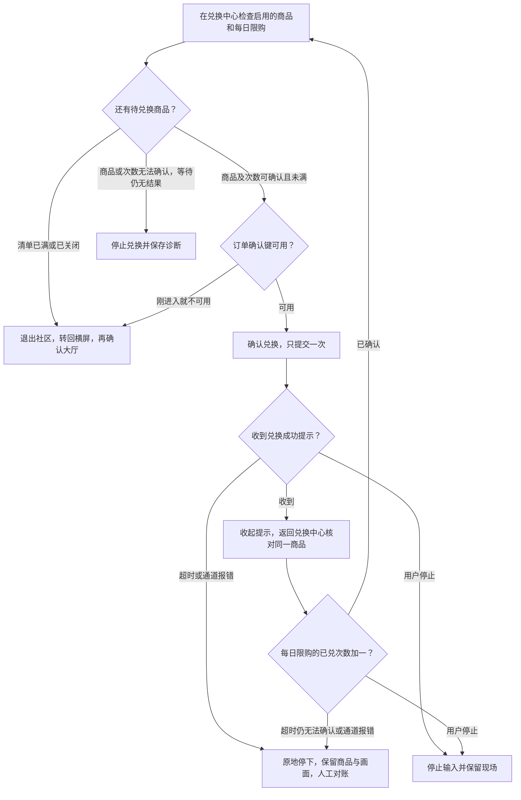

# 社区签到 community · 业务契约

从国服模拟器大厅开始，完成每日签到、浏览和分享，再按授权兑换。正常完成时由路线关闭竖屏社区，公共收尾确认横屏大厅。交易结果不明时保留现场，等玩家对账。[使用与停止](../USER_GUIDE.md#4-接力结果与停止)

## 这条路线在游戏里干什么

每天安排一次。已签到或已完成的任务按游戏页面的状态跳过。默认用积分换行动力和两类下级万能强化石，兑到各自每日限购。金币卡不在清单内。行动力与强化石可分别关闭。发出兑换后，继续下一件前需要成功提示和该商品限购次数加一。

## 页面链路

```
大厅 → 左侧「活动」入口 → 游戏内活动页 →「更多精彩活动」→ 网页活动列表（横屏）
  →「游戏社区」入口（点下即转竖屏）→ 社区 H5 首页信息流（签到）→「我的任务」（浏览 / 分享）
  → 兑换中心（按清单兑换）→ 右上角 X「退出社区」→ 转回横屏 → 回大厅（收工）
```

- 竖屏 H5 内部是**叠层**：商品详情（栈根）→ 订单确认页 → 兑换成功弹窗，下层被压暗但依旧可见。
- 去「我的任务」不点底栏「我的」（那是个人主页）：走「兑换」图标 → 兑换中心 → 获取积分卡 → 我的任务，路过兑换中心那一帧**不做兑换决策**。
- 终点是**大厅首页**，不是「退出社区」：关掉社区只到网页活动列表（横屏），还要靠通用回家流程兜底 ESC 才接得上下一个任务。

### 兑换分支



已提交后只等回执。成功提示出现后，只允许收起它、必要时从商品详情退回兑换中心，并核对限购次数。等成功提示最多 90 秒，等计数更新最多 30 秒。超时、执行通道中断或出现不允许的动作时停止对账，单条运行保留现场，每日编排也停止且跳过末尾巡检。订单确认键初见即不可用时按本轮无法继续兑换退出，原因可能是余额不足，实际余额仍要在游戏里核对。

图从实际进入购买决策的兑换中心起步。商品数据不完整时先等待，连续五次进不去商品详情也会停止留证，属于提交前故障。实机正常批次覆盖成功回执、限购与回大厅。卡在确认页、回执迟迟不来、计数未更新、截图或发送超时和手动停止由离线回放验证。[验收证据](#验收证据)

## 判据为什么这么设计

每条写的是「靠哪一维排除外观同类、语义不同的对象」，不是调阈值的经验值。

- **叠层优先级先看层序、再看分数**：下层页面在上层被压暗后照样拿高分，只按分数挑必错；判「当前页」先按 `LAYER_ORDER` 定层（网络异常 / 兑换成功 / 订单确认 / 分享面板 / 空列表态依次盖在兑换中心、任务页、首页之上），再看层内分数。**空列表态必须排在兑换中心上面**：它是其子状态（标题还在），排下面会被判成正常兑换中心、接着去点不存在的商品卡。
- **同形按钮不能当判据，只取「上层会盖住」的那块**：底部「立即兑换 / 确认兑换」只差两个字、在下层暴露处分数几乎一样，怎么调阈值都落在死区；`order_confirm` 与 `redeem_done` 取同一块坐标、内容完全不同（固定免责提示 vs 弹窗本体），天然互斥。
- **两个栈根页没有专有正向特征 ⇒ 只能做兜底态**：首页信息流的底栏四格 / 放大镜是共享控件（判的是「在这个 Tab 的导航栈里」，帖子详情页底下也还在），商品详情被订单确认页盖得只剩一条压暗按钮。
  这两页**不设正向锚点**，由 `resolve_stack_root()` 用「栈根判据命中 + 该栈盖层一个都没命中」推出兜底态；**不要为了「有个正向判据」去调阈值硬凑** —— 那正是竞技场入口事故的形状。
- **判据只用该页专有且每次一样的东西**：居中标题、免责提示、弹窗本体、空列表文案、网络异常文案；共享控件与会变的内容（评论数、弹窗奖励、来回滑动的光球）一律不进模板 —— 这是「**模板不含会变内容**」那条铁律。
- **数字不用 OCR，走字形读法**：项目不引 OCR，社区页数字是固定字体的网页文本，字形模板足够且离线可复核。整串模板不行 —— 网页会因排版半像素差异重新栅格化，跨帧整串比对必挂；字形读法先按高度归一化再比，天然免疫。
  任务进度和每日限购（「当前 / 上限」）走字形读法。余额可供读数诊断，生产兑换决策由限购和确认键驱动。整串样本位于 `strings/`。
- **三态绝不猜**：读不出就返回「不知道」，不返回猜的值 —— 「认错比认不出更糟」，认错的数字会直接变成业务动作（兑错东西 / 少兑一件 / 重复兑换），认不出只是这一轮不报数。字模是判据的一部分，缺失时直接抛，**判据不许静默降级**（否则「积分够不够」会安静地失效）。
- **双通道接入由路线自己的意图决定、不每帧问窗口**：只换掉 `Runtime` 最底下四个原始通道（`_capture` / `_click` / `_swipe` / `_back`），上面每一层（查停止、写日志、全局弹窗守卫）照旧 —— 外面垫壳就得把这些再实现一遍，等于「同一行为两份实现」。
  方向只在换向那几秒轮询、锁定后一帧都不再问，换向途中「还没转过去」照样交给竖屏通道等；仅适用雷电模拟器 adb 后端，PC 后端在装配前拦下（否则静默点错客户端）。
- **收官次序「关在竖屏、收工在横屏」**：`main` 的「异常也回家」「正常回大厅」都拿横屏通道取图，人还在竖屏时抛结论或收工会抛「render size changed」，还把模拟器留在竖屏、下一个任务连大厅都回不去。
  三段必须在三个不同帧上：`CLOSING` 不判页面（只看方向）、结论只出现在横屏那一帧、动作与结论不许同帧（同帧动作会被跳过，表现是「该点的没点却报完成」）。
- **点赞任务摘掉（会死循环，用户拍板）**：点赞状态是服务端永久记住的 —— 点过的帖那颗点赞图标永远变实心，而判据只认「空心 = 还没点过」⇒ 翻得越久能点的越少 ⇒ 那一遍必然作废、回去重排又是这三屏；这不是尺子错、是任务本身随时间不可再完成。
  用户拍板「只保留分享 + 浏览」：只从任务行与脚本摘掉，点赞的代码 / 机制 / 护栏 / 模板**一律保留**，要恢复把那两行加回去即可。副作用是少拿一份积分，但余额不够时 `plan_redeem()` 如实报 insufficient 正常收手，**不会卡死**。
- **判据必须能证伪，不是「多个候选里挑最像的」**：点帖判据在「白底 / 有字 / 不是图片」之外再加「通栏」这一维 —— 作者行、标题、标签都是白底黑字的外观同类，前三条分不出，正文段落通栏才把它们**排除**掉；活动页靠 `activity_page_shell` 骨架认页、不靠「那一步要点的东西」（位置随列表滚动漂、没有上界）。
- **位移容差只给已取证的锚点，不降阈值**：同一控件跨采集日会有 1~2px 漂移，固定窗口会把已知页判成陌生页；只对留下了现场帧、量过反例边界的锚点在自身区域四周扩几像素搜索，阈值与模板不动。回执类锚点还必须证明订单确认、分享面板等相邻页不会过阈，否则会把「已兑换」读成没发生，导致重复提交。
- **判据只能有一份实现、兜底不许挂在走不到的分支**：`observe` 只委托 `judge_page`，跨帧对比的账本要进快照，「判据写好了、生产走不到」是反复踩到的同一类病。陌生页则**靠「能自己退出来」、不靠「认识得更多」**：H5 是开放页面集补不完，认不出时先等确认、再按返回键（不点屏幕中央）、按一次判一次，退回已知页把那一步重做，用尽逃生梯才抛错并把真实分数写进日志。

## 危险边界

- **订单只提交一次。** 先确认商品来源和限购读数。刚进入订单确认页时按钮灰，保存画面并正常退出。发出确认后按钮变灰时继续等回执。成功提示和限购加一齐备后才能继续，等待用尽时原地停止，按商品、限购和积分核对。
- **点开商品这一圈要有上界**：「打开商品 → 判不出商品详情 → 陌生页按返回 → 回兑换中心 → 再打开」每圈都会把状态计时重置，60 秒超时永远等不到；连着 5 次都没走到商品详情就收手留证据（`REDEEM_OPEN_ATTEMPT_LIMIT`），走通一次即清零。
- **不可逆的误点靠存在性判据 + 现找拦住**：回任务页要用的「兑换」图标随信息流滚动会滚出视野，图标模板**只作存在性判据、不产出点击点**，看不见就往回滚到顶，**绝不蒙着点**（那一按不可逆）；点帖用「现找正文带」而不是写死的盲坐标（卡片高由正文长短决定），找不到就收手、绝不退回盲点。
- **滑动起点一律在左边缘白边**：退化成点击时无害；起点落在信息流居中的插图上会打开图片查看器、整条路线卡死。
- **三种网络失败 / 全局浮层分开收治**：图片查看器、社区 H5 整页网络异常、游戏内 WebView 的网络错误长条是三种不同东西（按返回 / 下拉刷新 / 点右上角 ✕），不能合并处理；盖住整屏的浮层出现即宣布「这次转场作废、先收掉它」。全局弹窗由挂在 `runtime.capture` 上的守卫处理，不是状态机里的页面。
- **竖屏取图必须走实时通道**（2026-11-24 事故后立）：用 `adb exec-out screencap -p`，**不许拼「设备文件 + `adb pull` 到本地路径」**。命令字符串里的 Windows 路径会被 `shlex.split` 吃掉反斜杠，`pull` 把图写到别处且返回 0，程序照旧读那份不再更新的旧文件 —— 判页、点击、诊断帧全部围绕旧画面算，日志会一本正经地描述一个不存在的页面。判据见 `core/portrait.py::_screencap`。**多份诊断帧逐字节相同时，先怀疑取图，再怀疑页面**；不要把日志里的页名当现场事实。
- **转场契约**：每个动作发出前都过 `source_page` + 出口验收的机器校验；出口集合**不许含来源页**（含了点空也判完成），但要放行全局异常态。
- **认不出 / 超时 / 缺数据 → 安全停止留证，不猜着继续点**，见 [TRANSITION_CONTRACTS.md](../TRANSITION_CONTRACTS.md)；等转屏、等兑换结果这类长等待期间不出手、不报警，靠心跳日志与留一张现场帧可查，**诊断绝不打断主循环**。
- 每日签到与任务受游戏当日状态限制。涉及积分的实机验证单独获得授权。[工程安全矩阵](../SAFETY_MATRIX.md)

## 现行事实（不写数字，链机器产出）

- 路线可用范围、次数、接力和验收状态见[现状速查](../STATUS.md)。
- 竖屏页面判据与层序：`games/epic7/community_pages.py`；数字读数：`games/epic7/community_numbers.py`；状态机 / 动作 / 兑换清单 / 双通道 / Runner：`games/epic7/community.py`；竖屏 adb 链路本体：`core/portrait.py`。
- 横屏导航锚点 / 活动页骨架与扫描：`games/epic7/navigation.py`、`games/epic7/activity_column.py`；导航链 / 接力白名单 / 发送层钩子：`games/epic7/modes.py`、`games/epic7/navigation_plan.py`、`games/epic7/runner_base.py`；回家终点契约：`games/epic7/finish_home.py`。
- 注册 / 每日任务 / 桌面目录：`games/epic7/modes.py`、`games/epic7/daily_tasks.py`、`desktop/catalog.py`。
- 转场契约登记见 [TRANSITION_CONTRACTS.md](../TRANSITION_CONTRACTS.md)，接力覆盖见 [RESUME_COVERAGE.md](../RESUME_COVERAGE.md)（本路线在 `RESUME_EXEMPT` 里，接力只登记不实现，理由在 `modes.py`）。
- UI 改版怎么改（取证 → 换模板 → 区域 → 阈值 → 反例）见 [EXTENDING.md](../EXTENDING.md) §0 与 [TEMPLATE_CAPTURE.md](../TEMPLATE_CAPTURE.md)；**不许为了过单张截图降阈值**。
- 兑换图的下单、回执及限购核对入口在 [community.py](../../games/epic7/community.py) 的 `_on_order_confirm`、`_on_exchange_center`、`_perform_action` 与 `_hold_until_receipt`。在途期间停用全局弹窗输入，标记本次转场作废以阻止公共循环重发确认。初见灰键退出到横屏后才报告 `RedeemBudgetExhausted`。异常回执走 `PurchaseReceiptUnclear`；异常停手和横竖屏交接分别由 [每日编排](../../games/epic7/daily_tasks.py) 和 [公共终点](route_finish_points.md)承接。
- 回归分别覆盖[真实执行器离线交易](../../tests/test_community_redeem_receipt.py)、[路线状态机](../../tests/test_community.py)与[页面判据](../../tests/test_community_pages.py)。首页及帖子详情漂移有完整帧，分享面板和订单确认页可作回执反例。历史回执漂移有日志分数及离线变体，仍缺对应真机整帧。

## 验收证据

**正常批次。** 2026-11-27，国服模拟器桌面每日编排 07:55:12–08:34:22，社区段 08:27:44–08:31:51。签到有成功提示，浏览和分享均回任务页核对。四次确认各有成功回执。行动力两笔、装备强化石和饰品强化石各一笔，限购计数更新后确认清单满额，返回横屏大厅再启动成就领取。

**对账范围。** 按报价推算本段消耗 140 积分。兑换前后积分余额未成对记录，实际差额未知。游戏版本、模拟器版本和可对应发行候选的修订或工件未知。该记录支持本工作区在这次模拟器每日入口正常主流程的结论；公开稳定支持仍待复核。

**历史异常。** 2026-11-26 14:21 入口首页漂移被误判并退出。16:57 批次中，帖子详情和兑换回执漂移，旧行为发出两次确认输入，最终人工停机并回大厅。该次有行动力限购满额记录，逐笔余额未知。晚间整改的重复提交、回执超时与手动停止由离线回放验证。

**证据保管线索。** 原始日志由实机记录保管方留存。正常批次的社区日志 `epic7_community.log` 第 22832–23079 行，四次提交及回执在第 22978–23065 行；段间日志 `epic7_daily_probe.log` 第 2758 行；工作进程日志 `desktop_worker.log` 第 18571–18572 行。历史入口和异常批次分别在社区日志第 22431–22458、22459–22831 行。按日期、路线及这些行号向[待办评审](../TODO.md#社区签到)请求脱敏原始摘录。上面的结论随本手册保留。

## 已知缺口

[社区签到缺口及关闭条件](../TODO.md#社区签到)
