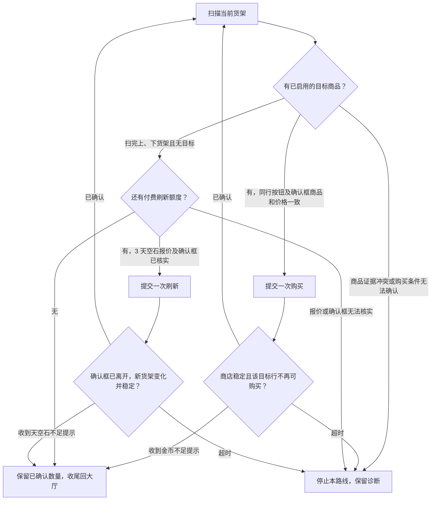

# 刷书签

从大厅进入秘密商店，或从已识别的商店货架接手。先检查授权和刷新额度，再扫上、下两段货架。每次换货后扫完新货架，包括最后一次刷新出的货架。确认结果后退出商店，由公共收尾确认大厅。[玩家设置](../USER_GUIDE.md#刷书签消费与对账)

## 购买授权与刷新额度

- 启动后按当前设置购买誓约书签、神秘书签和启用的友情点数，消耗金币。友情点数默认开启，上限 10 个，达到上限后跳过该商品。
- 付费刷新默认 0 次，只处理当前货架。设为正数时，每次刷新必须核实 3 天空石报价，且只用剩余额度。以已确认的新货架计刷新次数。
- 购买前检查商品和同行购买按钮，再核对确认框的商品及报价。同样的确认框可装不同商品，确认框或按钮的外观只能用于定位。已明确售罄或识别为本轮已购的槽位跳过；目标行缺按钮又无法确认已购时停止查证。

## 购买与刷新决策

每笔购买由程序按稳定货架及原目标行是否仍可购买记账。刷新以确认框离开、货架确实变化且重新稳定为依据。两类程序回执都需要用游戏内余额或流水核对实际资源变化。离线样本覆盖誓约和神秘确认框、明确售罄、最后一批扫描以及确认只提交一次。仍需在目标实机组合核验遮挡、同排商品相似、欠费提示和售罄反例。[交易实现](../../games/epic7/shop_refresh.py) · [识别规则](../../games/epic7/evidence/shop_refresh.py) · [交易回归](../../tests/test_shop_refresh_runner.py) · [页面回归](../../tests/test_shop_refresh_evidence.py)

## 异常与收尾

金币或天空石不足有明确提示时，保留已确认的计数并正常退场。用户停止则结束输入。交易超时会保留诊断并停止刷书签。当前这条路线把回执不明当作普通运行错误，公共入口仍会尝试回大厅。每日编排可能在确认大厅后继续下一项。看到回执不明时请主动安全停止整轮，核对余额、库存与货架后再决定是否重跑。统一保留待对账现场及停止每日编排的行为待验。[通用生命周期](../ARCHITECTURE.md#桌面任务生命周期) · [刷书签待办](../TODO.md#刷书签)

## 验收证据

| 声明 | 已确认范围与保管线索 |
| --- | --- |
| 模拟器桌面每日入口正数刷新 | 2026-11-27 08:06–08:21，刷新 50 次、购买 14 笔（誓约 2、神秘 2、友情 10），确认回大厅。日志按报价记 150 天空石和 1,108,000 金币。原始日志 `epic7_shop_refresh.log` 第 23435–24048 行，末两行是终点及汇总。游戏版本、候选工件及账户余额差额待核。 |
| 历史零刷新和 PC 记录 | 同日志第 20743 行记录零刷新、购买一笔友情点数。当前候选与桌面默认组合仍待验。历史 PC 样本验证前台拖拽后可继续扫描，仍有一轮停在 96/100。记录及边界见 [0006 PC 滑动](../decisions/0006-pc-slide-must-foreground.md)。 |
| 历史未决购买 | 2026-11-11 08:37:13 确认已发送，08:37:35 回执仍未知，价格为 18,000 金币，实际扣款待核。同日志第 11619、11623 行。 |
| 历史程序已记购买成功 | 同日 11:59:58 程序已记友情点购买及 18,000 金币，随后下段货架缺同行按钮而失败。该笔账户流水待核。同日志第 11686、11692 行。 |

这些记录可用于核对指定工作区和历史分支。原始日志由实机记录保管方按文件名、日期与行号提供脱敏摘录。当前候选要复验的条件见[刷书签待办](../TODO.md#刷书签)。历史页面素材的来源见[模板来源](../../games/epic7/templates/shop_refresh/SOURCES.md)。
