# 英雄合成：代码实际使用的局部截图审查

这份文档只展示代码用于判断的局部图，不展示完整流程图。

所有图片均为从项目截图中按代码坐标直接裁剪，未放大、未缩小、未重新生成。图片在聊天窗口中可能会被界面缩放，但文件本身保留标题中的原始像素尺寸。

## 1. SSS 材料判断

代码位置：`games/epic7/hero_synthesis.py:147, 376-384, 613-619`

判断方式：

```text
搜索区域：x=1750, y=350, w=230, h=650
模板尺寸：64×38
阈值：0.80
页面：刻印材料页
```

### 代码使用的 SSS 小模板


文件：[template_sss_material_64x38.png](hero_synthesis_crops/template_sss_material_64x38.png)

### 真实材料截图中的完整搜索区域

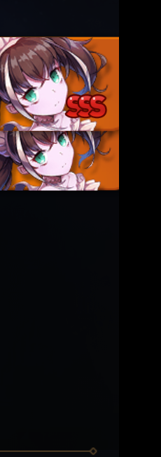

文件：[source_sss_material_search_region_230x650.png](hero_synthesis_crops/source_sss_material_search_region_230x650.png)

### 真实截图中实际命中的 64x38 区域


文件：[source_sss_material_matched_64x38.png](hero_synthesis_crops/source_sss_material_matched_64x38.png)

这张真实截图的命中位置是 `(1845,480)`，匹配分数为 `1.0`。请重点确认：这个小图是否确实只截到了材料卡上的 SSS，而没有依赖人物头像或整张卡背景。

### 发现 SSS 后的动作

代码在 `IMPRINT_ADD` 状态中先判断 SSS 材料，再判断绿色合成按钮：

```text
发现 SSS → pending_transmit_target=True
         → 点击返回箭头退出刻印页
         → 回到英雄列表
         → 打开当前英雄的“传送英雄”入口
```

对应完整来源图：[imprint_sss_material.png](../../tests/fixtures/epic7_hero/imprint_sss_material.png)

## 2. 左侧评级 SSS 判断

代码位置：`hero_synthesis.py:143-145, 332-349, 722-724`

判断方式：

```text
搜索区域：x=90, y=460, w=200, h=130
模板尺寸：124×90
阈值：0.90
页面：英雄列表
```

### SSS 模板


文件：[template_rating_sss_124x90.png](hero_synthesis_crops/template_rating_sss_124x90.png)

### 真实英雄列表中代码实际搜索的区域

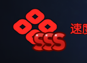

文件：[source_rating_region_list_grey_3s_180x130.png](hero_synthesis_crops/source_rating_region_list_grey_3s_180x130.png)

人工判断规则：

- 这里识别到 SSS：跳过当前英雄。
- 右侧即使有红点，也仍然跳过。
- 只有没有识别到 SSS 时，才继续判断红点。

完整来源图：[list_grey_3s.png](../../tests/fixtures/epic7_hero/list_grey_3s.png)

## 3. 红点判断

代码位置：`hero_synthesis.py:146, 353-374`

代码只检查刻印按钮左上角附近的 `50×50` 区域：

```text
红点区域：x=1030, y=935, w=50, h=50
```

### 有红点时实际检查的局部图

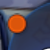

文件：[source_reddot_zone_present_50x50.png](hero_synthesis_crops/source_reddot_zone_present_50x50.png)

### 无红点时实际检查的局部图


文件：[source_reddot_zone_none_50x50.png](hero_synthesis_crops/source_reddot_zone_none_50x50.png)

人工判断规则：

```text
SSS                      → 跳过
非 SSS + 无红点           → 跳过
非 SSS + 有红点           → 进入刻印
```

## 4. 刻印按钮模板判断

代码位置：`hero_synthesis.py:135-142, 703-730`

### 正常刻印按钮模板

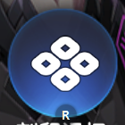

文件：[template_imprint_button_normal_140x140.png](hero_synthesis_crops/template_imprint_button_normal_140x140.png)

### 置灰刻印按钮模板

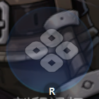

文件：[template_imprint_button_grey_140x140.png](hero_synthesis_crops/template_imprint_button_grey_140x140.png)

### 代码实际搜索的大区域

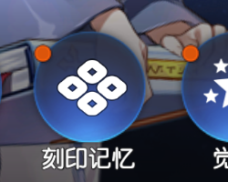

文件：[source_button_zone_reddot_250x200.png](hero_synthesis_crops/source_button_zone_reddot_250x200.png)

### 真实按钮位置的 140x140 局部图

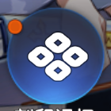

文件：[source_button_exact_reddot_140x140.png](hero_synthesis_crops/source_button_exact_reddot_140x140.png)

当前结构匹配下限为 `0.50`，这是为了兼容模拟器实际按钮视觉变化；红点和 SSS 仍由独立区域判断。

### 三个“按钮截图”到底分别是什么

| 名称 | 文件 | 尺寸 | 运行时作用 | 当前阈值 |
|---|---|---:|---|---:|
| 正常按钮模板 | `templates/hero/imprint_button_normal.png` | 140×140 | 与当前画面匹配，作为按钮结构候选 | 最终结构分数 ≥ 0.50 |
| 灰色按钮模板 | `templates/hero/imprint_button_grey.png` | 140×140 | 与当前画面匹配，作为按钮结构候选 | 最终结构分数 ≥ 0.50 |
| 真实按钮局部截图 | `source_button_exact_reddot_140x140.png` | 140×140 | 仅用于人工核对当前按钮长什么样，不是第三个运行时模板 | 不参与判断 |

实现细节：`_locate_button(..., 0.0)` 会先分别找正常模板和灰色模板的最高匹配分；随后 `best.score >= _BUTTON_STRUCT_MIN` 才认为按钮结构存在。红点不使用这两个模板的分数，而是在独立的 `50×50` 区域做 HSV 颜色识别。因此 `0.50` 不是“SSS 阈值”，也不是“红点阈值”。

## 5. 筛选面板判断

代码位置：`hero_synthesis.py:642-692`

### 筛选等级锚点

模板：

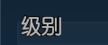

来源搜索区：

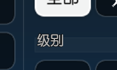

### 3 星已选状态

模板：

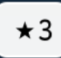

来源搜索区：

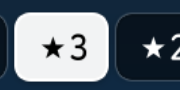

### 漏斗按钮

模板：

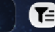

来源搜索区：

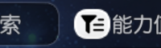

## 6. 传送页判断

代码位置：`hero_synthesis.py:580-603`

### 自动选择标签

模板：


来源搜索区：

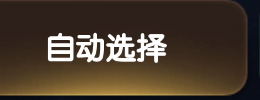

### 传送页其它实际判断区域

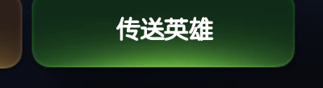

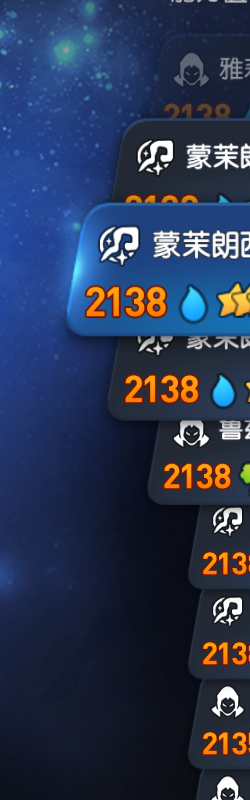

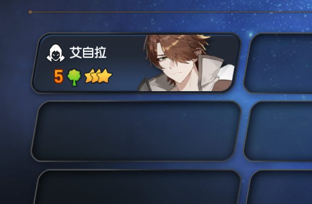

人工重点确认：传送页选择的应该是“当前无等级副本”，不是触发中止的 SSS 材料卡。

## 7. 合成页实际判断区域

### 绿色合成按钮区域

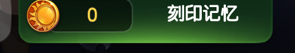

### Up 材料纵向区域

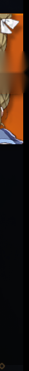

代码位置：`hero_synthesis.py:620-635`。

## 8. 确认弹窗和结果覆盖层

### 确认弹窗蓝色/金色联合判断区域

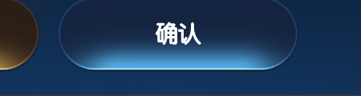

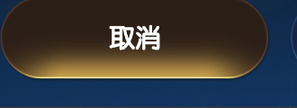

代码位置：`hero_synthesis.py:563-573`。

### 合成结果标题和关闭区域

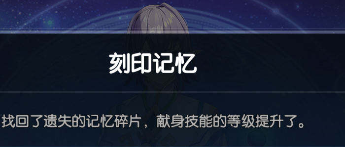

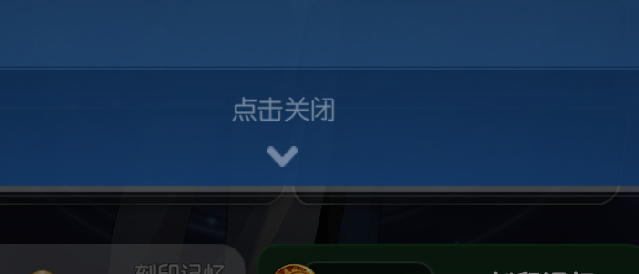

代码位置：`hero_synthesis.py:555-561`。

## 9. 当前“下一张”判断的实际截图

代码位置：`hero_synthesis.py:148, 159, 529-549`

### 判断右侧是否还有下一张卡

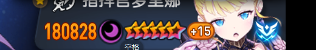

代码通过这块区域的亮度判断右侧列表下方是否还有卡片。没有下一张时，完成一轮；有下一张时，生成 `next_card_*` 动作。

### 详情指纹区域

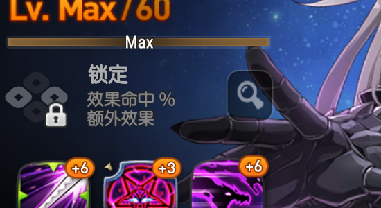

代码把这块区域缩小成 `5×3` 灰度数据，再生成动作名后缀，用于确认翻卡动画完成。

人工重点审查：

- 这个区域是否足够区分相邻英雄；
- 截图时机是否处于稳定的英雄详情页；
- `next_card_*` 动作点击位置是否确实落在下一张卡的可点击区域。

## 10. 当前结论

- SSS 材料小模板：`64×38`，实际截图中命中位置同尺寸，当前样本匹配分数 `1.0`。
- SSS 评级模板：`124×90`；搜索区域：`180×130`，只保留必要的左侧评级范围。
- 红点区域：`50×50`，只取刻印按钮左上角红点附近。
- 按钮结构区域：`250×200`，模板本身 `140×140`。
- 当前真实测试已经确认新的“下一张”坐标 `(1559,591)` 被实际发出，但页面没有切换；因此下一步需要优先人工确认这些裁剪图和页面时机，而不是继续盲目改坐标。
