# 第七史诗：模拟器英雄合成人工审查包

这份文档用于把“代码判断”和“截图画面”一一对应起来。请重点审查：

1. 当前英雄是否应该跳过、进入合成，还是进入传送。
2. 刻印材料里出现 SSS 后，传送的目标是否是当前无等级副本，而不是右侧材料里的 SSS 卡。
3. 传送完成后是否应该回到英雄列表继续当前轮次。
4. 列表右侧“下一张”点击位置是否符合人工操作。

## 一、当前总流程

```text
大厅
  ↓
英雄列表
  ↓ 首次进入时打开筛选
筛选 3 星并关闭筛选
  ↓
读取当前英雄
  ├─ 当前 SSS                  → 跳过，下一张
  ├─ 当前非 SSS、无红点         → 跳过，下一张
  └─ 当前非 SSS、有红点         → 进入刻印
                                  ↓
                              添加 Up 材料
                              ├─ 材料中出现 SSS → 返回列表
                              │                    ↓
                              │                打开“传送英雄”
                              │                    ↓
                              │                传送当前无等级副本
                              │                    ↓
                              │                返回列表继续
                              └─ 没有 SSS       → 合成、确认、关闭结果、返回列表
```

代码入口：`games/epic7/hero_synthesis.py` 的 `HeroSynthStateMachine.next_action()`。

## 二、英雄列表判断

### 1. 当前 SSS：跳过

截图：


代码依据：

- `hero_synthesis.py:143-145`：在左侧详情区域识别 `SSS`。
- `hero_synthesis.py:722-724`：识别到 SSS 后进入跳过/下一张。
- `hero_synthesis.py:529-549`：有下一张就生成 `next_card_*` 动作，没有下一张就完成一轮。

人工要确认：左侧红色评级为 SSS 时，无论刻印按钮有没有红点，都不应进入合成。

### 2. 当前 SSS 且有红点：仍然跳过

截图：

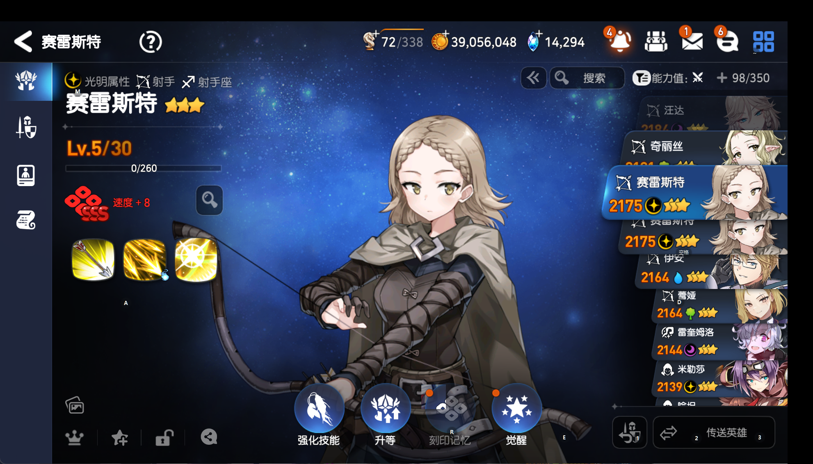

代码依据：仍然先判断 SSS，再判断红点。也就是 SSS 优先级高于红点。

### 3. 当前非 SSS、无红点：跳过

截图：

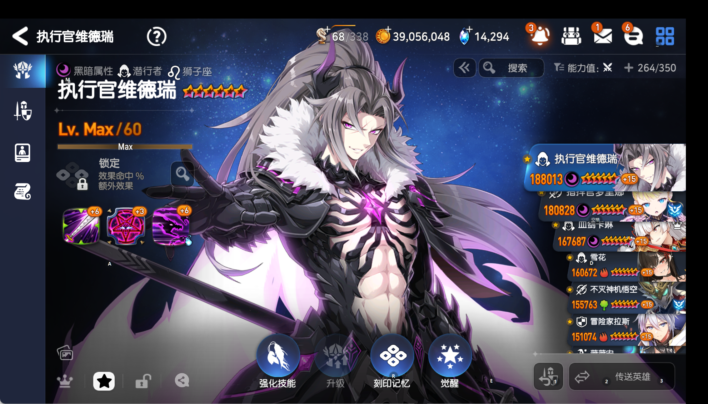

代码依据：

- `hero_synthesis.py:703-730`：识别按钮结构后，非 SSS 且无红点时调用下一张逻辑。
- `_BUTTON_STRUCT_MIN` 当前为 `0.50`，用于兼容模拟器按钮的轻微视觉变化。

### 4. 当前非 SSS、有红点：进入合成

截图：

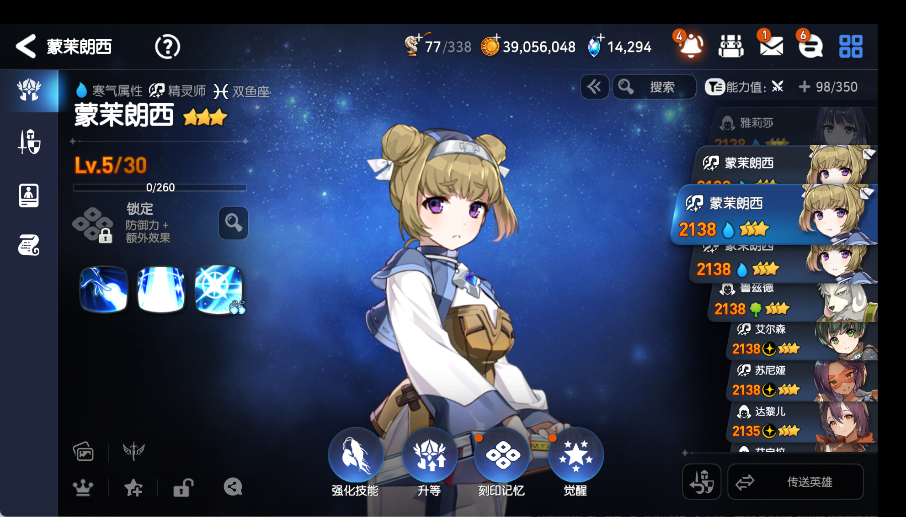

代码依据：

- `hero_synthesis.py:725-728`：红点存在时返回 `open_imprint`。
- 只有当前卡不是 SSS 时，红点才有进入合成的意义。

## 三、筛选 3 星

截图：

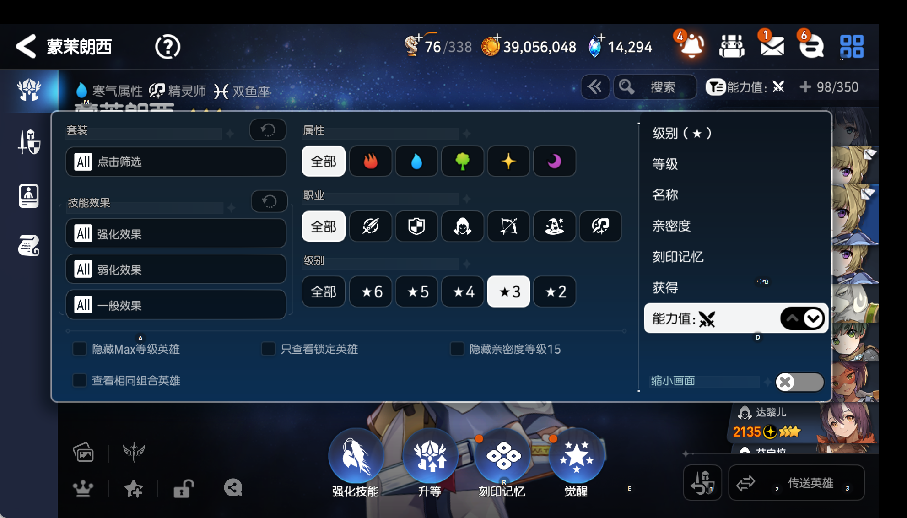

代码依据：

- `hero_synthesis.py:642-687`：识别筛选面板、选择 3 星、确认选中后关闭筛选。
- `hero_synthesis.py:203-204`：`_filter_session_done` 防止关闭筛选后因残留模板再次打开筛选。

人工要确认：筛选关闭后，后续列表操作不应再次点击右上角漏斗。

## 四、刻印材料页

### 1. 普通材料：继续添加

截图：

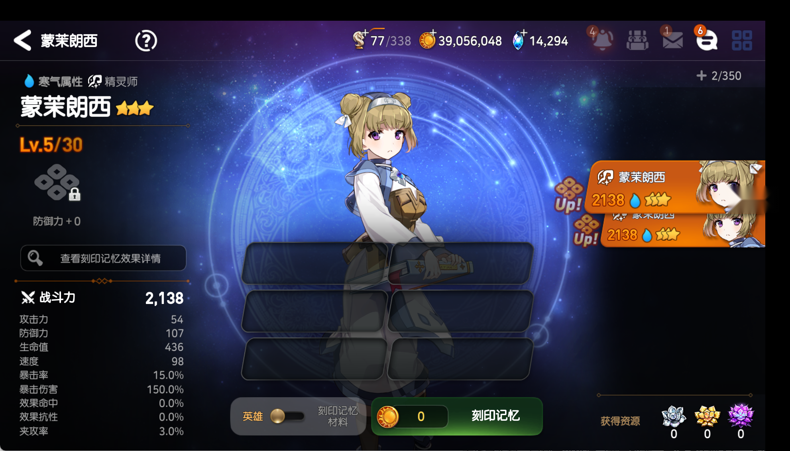

单张材料截图：

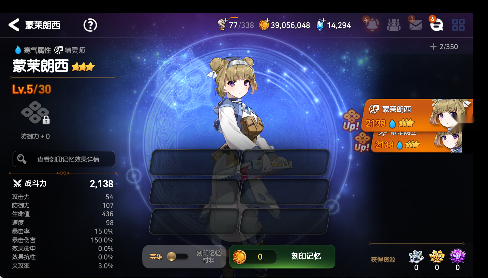

代码依据：

- `hero_synthesis.py:620-627`：找到 Up 材料后返回 `add_material_*`。
- `hero_synthesis.py:628-635`：没有剩余 Up 材料时，点击绿色按钮开始合成。

### 2. 材料中出现 SSS：停止合成并返回列表

截图：

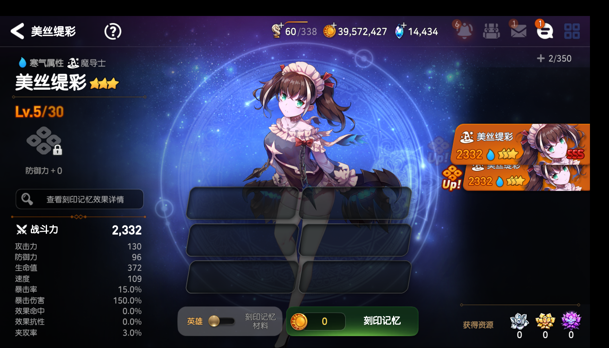

这张图是当前模拟器流程使用的 SSS 材料证据；模板本身是只截取 SSS 小区域的：


代码依据：

- `hero_synthesis.py:147`：SSS 材料搜索区域在刻印材料列表右侧。
- `hero_synthesis.py:613-619`：发现 SSS 后设置 `pending_transmit_target=True`，点击返回箭头退出刻印页。
- 动作名：`abort_imprint_to_transmit`。

人工要确认：这里返回的目标是“当前正在处理的英雄”，不是材料列表中那张 SSS 卡。

## 五、传送流程

### 1. 返回列表后打开传送英雄

当前待传送标志为真时，代码执行：

- `hero_synthesis.py:698-702`：返回 `open_transmit_for_current_card`。
- 点击点是右下角的“传送英雄”入口。

### 2. 传送选择页

截图：

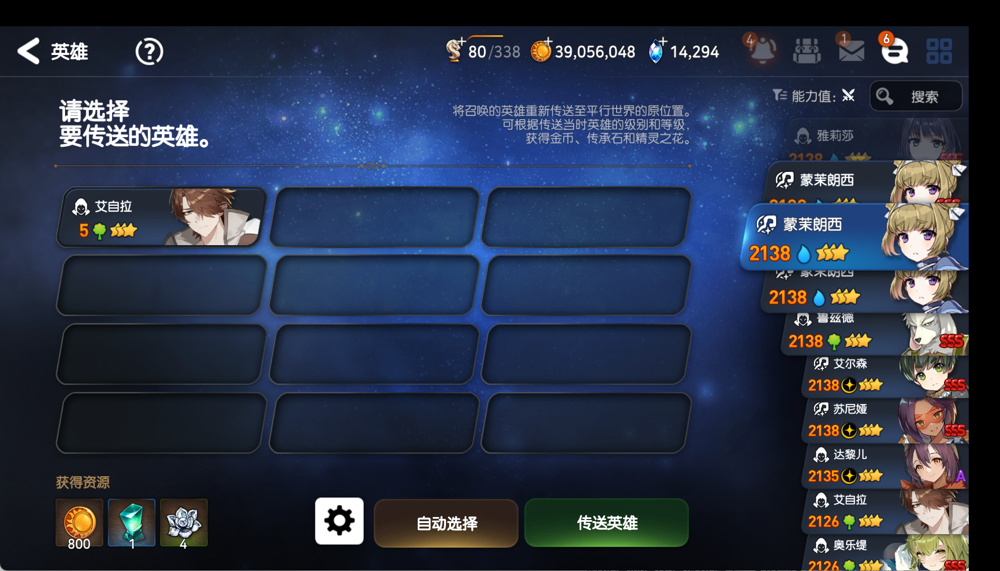

选择后截图：

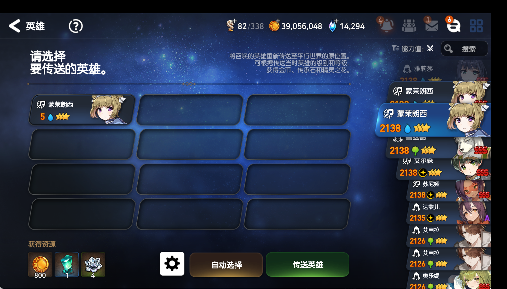

代码依据：

- `hero_synthesis.py:580-603`：以“自动选择”标签识别传送页。
- `hero_synthesis.py:592-598`：识别要传送的卡并点击。
- `hero_synthesis.py:582`：进入传送页后清除 `pending_transmit_target`，避免重复打开传送。

人工要确认：传送页里被选中的应是当前无等级副本；SSS 材料只是触发停止合成的原因，不是传送目标。

### 3. 传送确认和奖励

截图：

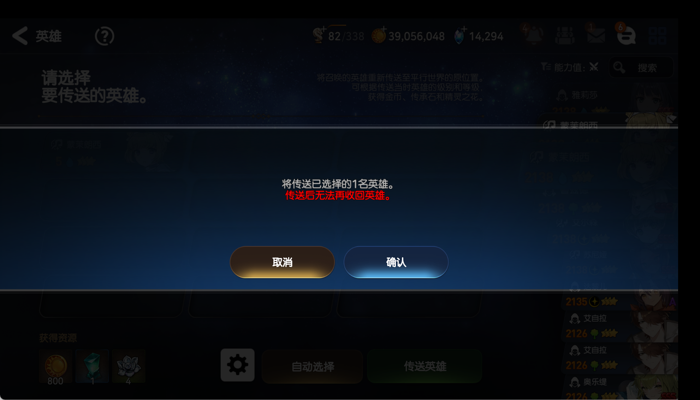

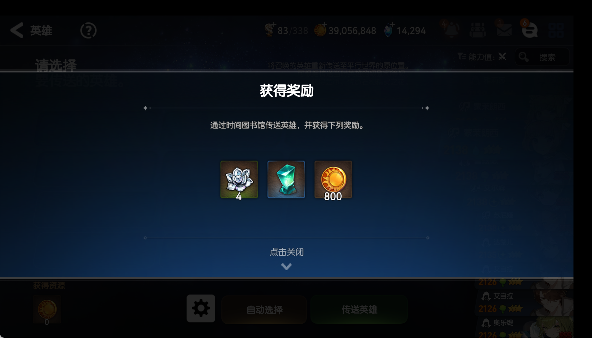

代码依据：

- `hero_synthesis.py:563-573`：识别确认弹窗并区分合成确认/传送确认。
- `hero_synthesis.py:575-578`：传送奖励出现后关闭奖励层，回到传送选择状态。

## 六、正常合成流程

刻印材料已就位：

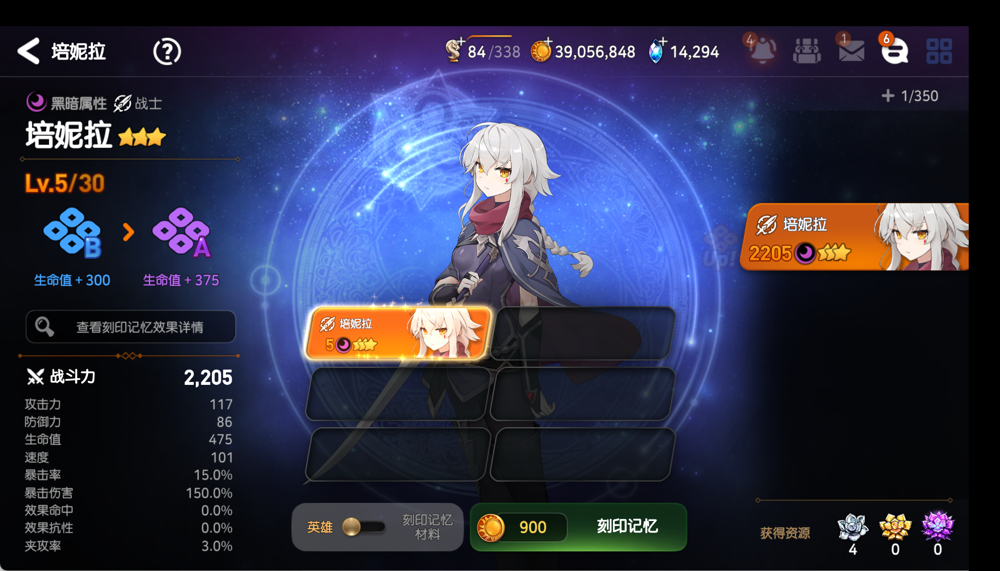

合成确认：

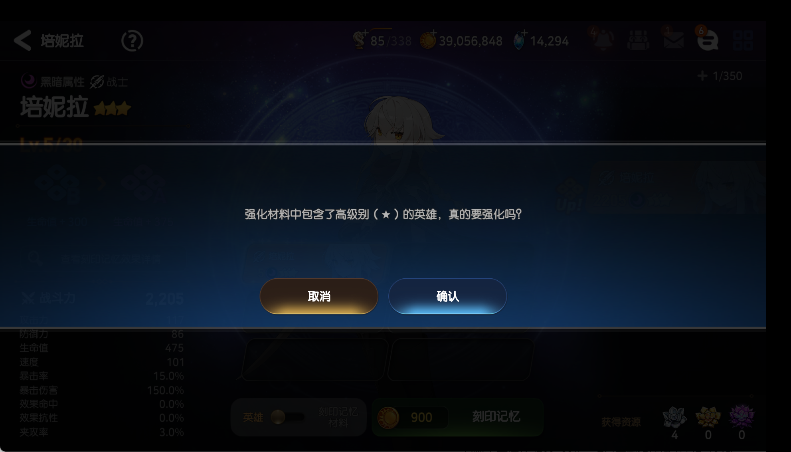

合成结果：

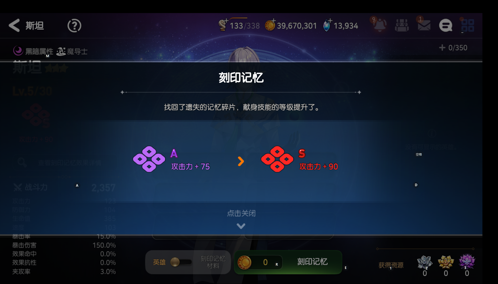

结果关闭后：

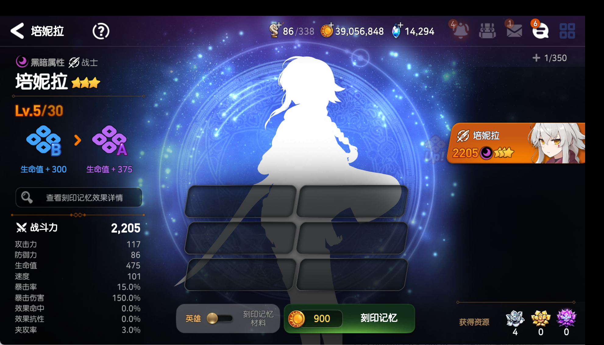

代码依据：

- `hero_synthesis.py:628-635`：开始合成。
- `hero_synthesis.py:563-573`：确认合成。
- `hero_synthesis.py:555-561`：优先关闭合成结果覆盖层。
- 关闭结果后回到英雄列表继续遍历。

## 七、当前“下一张”点击位置

你提供的人工截图红框在原始 `1920×1080` 渲染画面中约为：

```text
红框范围：x=1518~1600，y=518~559
红框中心：x≈1559，y≈539
```

模拟器内部使用的是顶部补 52 像素的 `1982×1132` 画布，因此代码使用：

```text
模拟器：_NEXT_CARD_POINT = (1559, 591)
PC：    _PC_NEXT_CARD_POINT = (1710, 570)
```

代码位置：`hero_synthesis.py:161-167` 和 `hero_synthesis.py:544-549`。

人工标注图：


当前真实测试结果：日志已经确认模拟器实际点击了 `(1559,591)`，但点击后当前英雄仍没有切换。因此“下一张”问题目前不能简单归因于坐标偏移，仍需人工确认截图中的红框是否确实是可切换的列表卡点击区域。

## 八、建议人工重点检查的三件事

1. `list_reddot.png`：当前英雄是否真的是“非 SSS + 红点”，是否应该进入刻印。
2. `imprint_sss_material.png`：出现 SSS 后，应该返回并传送哪一张英雄。
3. `user_next_card_point_render_1559_539.png`：绿色点是否落在你人工点击“下一张”时的有效区域内；如果是，下一步就查输入/页面响应，不再改坐标。

## 九、当前验证状态

- 英雄合成及 PC 证据测试：`61 passed`。
- 全量测试：`405 passed, 47 subtests passed`。
- 最近一次坐标修正提交：`a619ac1`。
- SSS 材料传送逻辑提交：`6a1a2c0`。
- 当前未解决：模拟器真实测试中，点击下一张后列表没有可靠切换。
